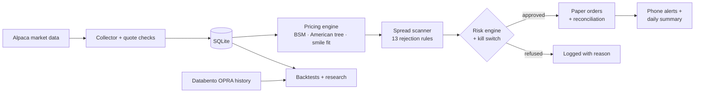
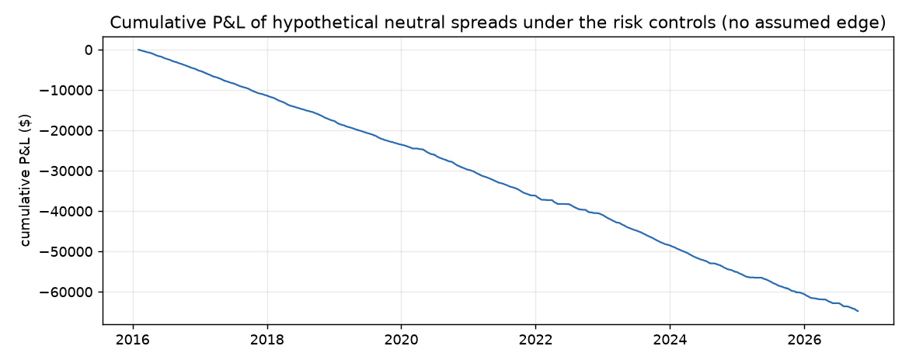

<div align="center">

# 📈 Options Quant

**A local-first research and paper-trading system for SPY options, built to find out honestly whether an edge exists, and to refuse to trade when it doesn't.**


[](LICENSE)

</div>

> **Paper trading only.** This project trades a simulated Alpaca paper account. There is no live-money code path: live mode is refused outright in this build. Nothing here is investment advice.

---

## What it does

Options Quant runs on a Mac, unattended, every trading day:

1. **Collects** the full SPY options chain every 15 seconds: bid/ask, sizes, Greeks, and quote timestamps. Each quote is checked for problems (crossed, stale, too wide) before it's used.
2. **Prices** every contract with its own engine (Black-Scholes-Merton, a binomial American tree, and a fitted volatility smile) and estimates how uncertain each price is.
3. **Scans** for defined-risk vertical spreads where the market price is far from fair value, measured against prices you could actually trade at, not mid-prices.
4. **Checks risk** on every idea before it can trade: position sizing, daily loss limits, stress tests calibrated on 10 years of history, a 4-level kill switch, and an exit plan written before entry.
5. **Trades on paper**, sending each spread as a single multi-leg order, then reconciling fills against the broker and recovering cleanly after crashes or the Mac sleeping.
6. **Reports** a midday check-in, a daily summary, and urgent alerts to a phone via [ntfy](https://ntfy.sh) (free).



## What the research found so far

The goal is truth, not a pretty equity curve. Every test uses real bid/ask costs and only data available at that moment (no look-ahead). So far the honest answer is **no tradeable edge yet**, and the system has correctly declined to trade.

| Study | Result |
|---|---|
| [10-year risk replay](docs/research/risk_replay.md) | 10,559 simulated trades over 2,692 days; **0** lost more than their planned maximum |
| [Pricing residuals](docs/research/pricing_report_2026-10-19.md) | 46% of quotes *look* mispriced; after accounting for model uncertainty, only 0.8% remain, and those lost money |
| [Real-quote check](docs/research/real_quotes_finding_2026-10-19.md) | On 20 days of real OPRA quotes, the smile fits very tightly, but not enough mispricing survives to build a spread |
| [Spread scanner replay](docs/research/scan_report_2026-10-19.md) | 444 spreads built, **0** passed every rule, and every rejected group lost money afterwards |
| [Intraday volatility study](docs/research/intraday_vol_study.md) | 0 of 80 entry/exit combinations made money in both the discovery and the confirmation period |
| [Multi-day crash test](docs/research/multiday_crash_test_2026-10-19.md) | **Failed.** An apparent profit came from two data errors; once fixed, it averaged about $0 per trade, so the strategy was not built |
| [Walk-forward backtest](docs/research/backtest_2026-09-21_2026-10-16.md) | 0 of 2 out-of-sample windows made money |
| [Paper order demo](docs/research/paper_demo_2026-10-20.md) | **Passed.** Orders placed, filled, cancelled, and reconciled correctly end-to-end |

<p align="center">
  
  <br><sub>10-year risk-control replay: real SPY paths with neutral, no-edge trades. This tests whether the controls hold, not whether a strategy makes money.</sub>
</p>

## Safety, enforced in code

- **Paper only.** The single module allowed to send orders is hard-wired to Alpaca's paper endpoint and refuses live keys.
- **A test fails** if any order-sending call appears anywhere else in the code.
- **Defined risk only.** No spread can leave an uncovered short leg; a partial fill that would is detected and halts the system.
- **One config, validated at startup.** Unknown keys, out-of-range values, or conflicting limits stop the program. Risk limits live in a single file that environments can't override.
- **Kill switch** with four levels. Create a file named `STOP` in the project folder and the bot halts and closes positions on the next cycle.
- **Secrets never leave the machine.** Keys come from the shell or a git-ignored `.env`, and logs are scrubbed of anything key-shaped.

## Project status

| Phase | | Status |
|---|---|---|
| 1 | Foundation: config, credentials, logging | ✅ Done |
| 2 | Market data collection | 🟡 Built; gathering full sessions |
| 3 | Pricing engine | 🟡 Built; checking stability across days |
| 4 | Opportunity scanner and spread builder | 🟡 Built; needs more data |
| 5 | Risk engine, exits, kill switch | 🟡 Built; replayed on 10 years |
| 6 | Paper execution and reconciliation | 🟡 Built; paper demo passed |
| 7+ | Backtesting, observation, analyst, monitoring, live review | ⏳ Planned |

The full checklist is in [docs/MILESTONES.md](docs/MILESTONES.md).

## Tech stack

Python 3.13 · pandas · SQLite · Alpaca API (free market data + paper broker) · Databento OPRA (historical option quotes) · FRED (interest rates) · macOS launchd (scheduling) · ntfy (phone alerts) · pytest

## Quick start

```bash
git clone https://github.com/claytonhuck06/options-trading-bot.git
cd options-trading-bot
python3 -m venv .venv
.venv/bin/pip install -r requirements.txt
cp .env.example .env               # add your own Alpaca *paper* keys
.venv/bin/python -m pytest         # run the test suite
.venv/bin/python main.py check --env paper
```

You'll need a free [Alpaca](https://alpaca.markets) paper account. Keys are read from your shell (`ALPACA_API_KEY_ID`, `ALPACA_SECRET_KEY`, `ALPACA_BASE_URL`, or Alpaca's `APCA_*` names) or from the git-ignored `.env` file. Keys are never printed or logged.

<details>
<summary><b>All commands</b></summary>

```bash
.venv/bin/python main.py config            # validated config + dollar limits
.venv/bin/python main.py check --env paper # + read-only Alpaca connection check
.venv/bin/python main.py collect --env paper       # collect SPY options all session
.venv/bin/python main.py collect --env paper --once # one cycle, for a quick test
.venv/bin/python main.py price --env paper          # price the latest snapshot
.venv/bin/python main.py report --env paper         # residual research report for the latest day
.venv/bin/python main.py scan --env paper           # candidate spreads right now, with reasons (no orders)
.venv/bin/python main.py scan-report --env paper    # replay the scanner over the latest day
.venv/bin/python main.py history --env paper        # download SPY minute bars since 2016 (free)
.venv/bin/python main.py risk-replay --env paper    # stress calibration + 10-year risk-control replay
.venv/bin/python main.py killswitch --env paper     # status | stop | ack-warning | reset --authorization "..."
.venv/bin/python main.py paper-demo --env paper     # end-to-end order test on the paper account (market hours)
.venv/bin/python main.py trade --env paper          # paper-trade until the close (collector must be running)
.venv/bin/python main.py backtest --env paper --from 2026-09-21 --to 2026-10-16 --walk-forward 10,5
.venv/bin/python main.py after-close --env paper    # daily summary to the phone + storage cleanup
.venv/bin/python main.py storage status --env paper # live-data storage: status | cleanup | restore --date D
.venv/bin/python main.py notify --env paper --title "Hi" --message "test"   # phone alert
.venv/bin/python -m pytest                 # test suite
```

Environments: `development` (default) · `backtest` · `observation` · `paper` · `live`. Select one with `--env` or `OPTIONS_QUANT_ENV`.

</details>

<details>
<summary><b>Running it automatically every day (macOS)</b></summary>

### Daily collection

A launchd job (`com.optionsquant.collector`) runs `scripts/run_collector.sh` at 8:15 a.m. Central, Monday–Friday. It waits for the 9:30 ET open, collects until the close, and exits on holidays. Logs: `logs/collector_<date>.log`.

- The Mac must be on and awake. The job keeps it from idle-sleeping while it collects, but closing the lid still sleeps it. A run missed during sleep starts when the Mac wakes.
- Keys are read from the `export ALPACA_...` lines in `~/.zshrc`.

```bash
launchctl bootout gui/$(id -u)/com.optionsquant.collector   # turn off
launchctl bootstrap gui/$(id -u) ~/Library/LaunchAgents/com.optionsquant.collector.plist  # turn on
```

### Dual momentum (paper)

`com.optionsquant.momentum` runs `scripts/run_momentum.sh` at 8:10, 10:00 and 1:00 Central on weekdays. On the first trading day of each month (or at the next run, if one was missed) it holds the top 2 of SPY/EFA/IEF/VNQ/DBC by 12-month return, each only while it's above its 10-month average, 20% of equity in all. Other days it exits at once. `python main.py momentum plan` shows this month's signal; `momentum status` shows holdings; `momentum resize` trades this month's holdings to a new size right away. Logs: `logs/momentum_<month>.log`.

The `.plist` files in `scripts/` contain absolute paths for the original machine; edit them to match your project folder before installing.

**Moving to another Mac:** turn the seven jobs off on the old Mac, copy the whole project folder (databases included), then run `zsh scripts/setup_new_mac.sh` on the new one. It rebuilds `.venv`, asks for any missing keys, checks the Alpaca paper connection and the tests, and installs the jobs with the new folder's paths.

### Daily paper trading

A second job (`com.optionsquant.trader`) runs `scripts/run_trader.sh` at 8:20 a.m. Central on weekdays. It runs the morning check (unknown orders, overnight assignments, broker vs. local records, missed days), waits for the open, then trades until the close. It needs the collector running. On its first run it does the paper demo and only trades if that passes. Log: `logs/trader_<date>.log`.

### Phone alerts and the daily summary

Alerts go through ntfy (free). Install the **ntfy** app and subscribe to the topic in `.env` (`OPTIONS_QUANT_NTFY_TOPIC`; keep it private, because anyone with the name can read the alerts). Urgent events are pushed at once: kill switch, early assignment, a position closed after an overnight gap, a halt at startup, a failed paper demo, the collector or trader stopping, missed trading days. A fourth job (`com.optionsquant.midday`, 12:00 p.m. Central) sends a short check-in: are the collector and trader alive, is the data fresh, what the screener has checked so far and why nothing passed, and any trades. Trades arrive in one summary after the close, which also reports the screener's day and how many days in a row nothing has passed: a third job (`com.optionsquant.afterclose`, 3:20 p.m. Central) runs `main.py after-close`, which also cleans up old live data (newest 5 days full detail, then one quote per minute, archived to compressed files after 30 days).

### Stopping trading immediately

Any of these work:
- create a file named `STOP` in the project folder (the kill switch halts and flattens on the next cycle)
- `.venv/bin/python main.py killswitch stop --env paper`
- set `trading.enabled: false` in `config/environments/paper.yaml`
- `launchctl bootout gui/$(id -u)/com.optionsquant.trader` (turns off the daily start)

</details>

<details>
<summary><b>Code layout</b></summary>

| Folder | Role |
|---|---|
| `config/` | `settings.yaml`, `risk_limits.yaml`, one file per environment |
| `core/` | config loading and validation, credentials, logging |
| `data/` | collector, quote validators, SQLite storage, historical downloads |
| `pricing/` | Black-Scholes, Greeks, implied vol, American tree, rates, smile fits, pricing engine |
| `strategies/` | vertical spread builder, scoring and rejection rules |
| `risk/` | sizing, positions, risk engine, exits, hedging, kill switch, history-calibrated stress |
| `execution/` | read-only broker, paper broker, order manager, reconciliation, crash recovery, trading session |
| `backtesting/` | event-driven backtests on real historical quotes, walk-forward |
| `research/` | pricing-residual, scanner-replay and volatility studies |
| `agents/` | local LLM analyst (read-only, advisory; planned) |
| `monitoring/` | alerts, daily summary |
| `docs/research/` | every study's write-up and charts |

</details>

---

<sub>Built by <a href="https://github.com/claytonhuck06">@claytonhuck06</a>. For research and education. Options involve substantial risk, and past or simulated results don't predict future returns. Released under the <a href="LICENSE">MIT License</a>.</sub>
