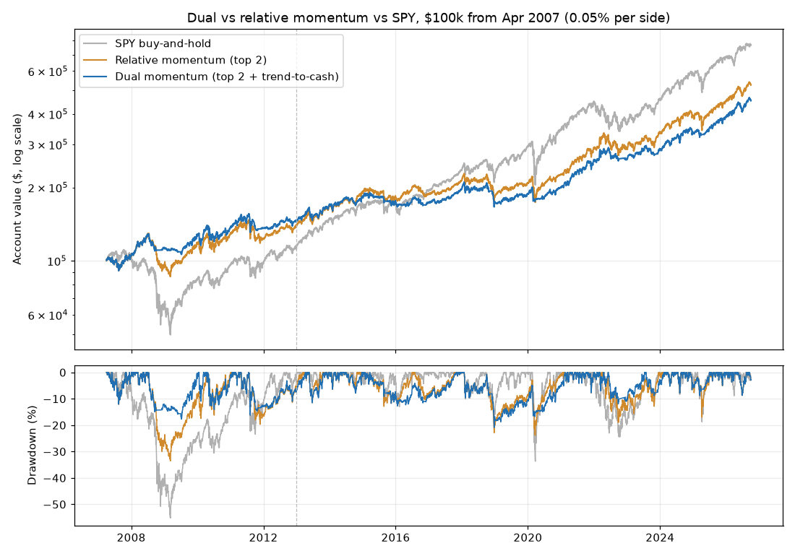

# Dual Momentum (Top 2 of 5 + 10-Month Trend-to-Cash) Backtest — 2026-10-20

*Paper research only; not investment advice. Rules: [dual_momentum_preregistration.md](dual_momentum_preregistration.md), committed before this ran.*

## Verdict: **NO-GO** (7 of 9 bars passed)

| Bar | Result | Detail |
|---|---|---|
| 1 · Log check | PASS | 464 trades over 235 month-ends, 0 problems |
| 2 · Sharpe ≥ relative momentum's (full) | PASS | 0.66 vs 0.63 |
| 3 · Max drawdown ≤ 0.8 × relative momentum's (full) | PASS | 20.9% vs limit 26.8% (relative momentum 33.6%) |
| 4 · CAGR ≥ relative momentum's − 1.5 pp (full) | PASS | 8.06% vs 8.89% |
| 5 · Confirmation: Sharpe ≥ relative momentum's | **FAIL** | 0.71 vs 0.74 |
| 6 · Trend lookbacks 9 and 11 pass bars 2 and 3 | PASS | 9 mo: Sharpe 0.66, drawdown 20.9% (pass); 11 mo: Sharpe 0.65, drawdown 20.9% (pass) |
| 7 · At 0.25% per side, Sharpe ≥ relative momentum's | PASS | 0.59 vs 0.58 |
| 8 · vs SPY (full): Sharpe ≥ and drawdown ≤ SPY's | PASS | Sharpe 0.66 vs 0.66; drawdown 20.9% vs 55.2% |
| 9 · vs SPY (confirmation): Sharpe ≥ 0.9 × SPY's | **FAIL** | 0.71 vs limit 0.84 (SPY 0.93) |

## Results at 0.05% per side

**Full period: 2007-04-02 to 2026-09-30**

| | Total return | Annual (CAGR) | Max drawdown | Worst year | Sharpe | Trades | Time invested |
|---|---|---|---|---|---|---|---|
| Dual momentum | +353% | 8.06% | 20.9% | 2018 (-10.7%) | 0.66 | 464 | 85% |
| Relative momentum (top 2) | +426% | 8.89% | 33.6% | 2018 (-13.0%) | 0.63 | 527 | 100% |
| 5 assets, equal weight | +208% | 5.93% | 47.0% | 2008 (-26.1%) | 0.41 | 1170 | 100% |
| SPY buy-and-hold | +666% | 11.01% | 55.2% | 2008 (-36.8%) | 0.66 | 1 | 100% |

**Discovery: 2007-04-02 to 2012-12-31**

| | Total return | Annual (CAGR) | Max drawdown | Worst year | Sharpe | Trades | Time invested |
|---|---|---|---|---|---|---|---|
| Dual momentum | +45% | 6.74% | 17.6% | 2011 (-0.0%) | 0.57 | 133 | 80% |
| Relative momentum (top 2) | +39% | 5.88% | 33.6% | 2008 (-7.7%) | 0.42 | 156 | 100% |
| 5 assets, equal weight | +23% | 3.65% | 47.0% | 2008 (-26.1%) | 0.25 | 345 | 100% |
| SPY buy-and-hold | +13% | 2.18% | 55.2% | 2008 (-36.8%) | 0.16 | 1 | 100% |

**Confirmation: 2013-01-01 to 2026-09-30**

| | Total return | Annual (CAGR) | Max drawdown | Worst year | Sharpe | Trades | Time invested |
|---|---|---|---|---|---|---|---|
| Dual momentum | +212% | 8.62% | 20.9% | 2018 (-10.7%) | 0.71 | 331 | 86% |
| Relative momentum (top 2) | +279% | 10.17% | 23.9% | 2018 (-13.0%) | 0.74 | 371 | 100% |
| 5 assets, equal weight | +150% | 6.90% | 26.2% | 2022 (-11.3%) | 0.54 | 825 | 100% |
| SPY buy-and-hold | +577% | 14.92% | 33.7% | 2022 (-18.2%) | 0.93 | 0 | 100% |

*Time invested is the average share of the account in ETFs; the rest is in T-bills.*

## How often the cash rule acted

- Fully invested 74% of months, half in cash 21%, all cash 5%.
- Holdings changed at 87 of 234 monthly reviews (37%).
- Months a top-two fund was held out by the trend test: US stocks (SPY) 18, Foreign stocks (EFA) 4, Treasury bonds (IEF) 15, Real estate (VNQ) 20, Commodities (DBC) 15.

## Trend lookbacks (full period)

| | Total return | Annual (CAGR) | Max drawdown | Worst year | Sharpe | Trades | Time invested |
|---|---|---|---|---|---|---|---|
| 8 months (info only) | +389% | 8.49% | 18.4% | 2015 (-7.1%) | 0.74 | 450 | 81% |
| 9 months (bar 6) | +352% | 8.04% | 20.9% | 2018 (-10.7%) | 0.66 | 458 | 83% |
| 10 months (main) | +353% | 8.06% | 20.9% | 2018 (-10.7%) | 0.66 | 464 | 85% |
| 11 months (bar 6) | +344% | 7.95% | 20.9% | 2018 (-10.7%) | 0.65 | 467 | 86% |
| 12 months (info only) | +344% | 7.94% | 20.9% | 2018 (-10.7%) | 0.65 | 471 | 87% |
| Relative momentum (no cash rule) | +426% | 8.89% | 33.6% | 2018 (-13.0%) | 0.63 | 527 | 100% |

## Antonacci's absolute test instead (full period, information only)

A top-two fund is held only if its 12-month total return beats T-bills over the same 12 months.

| | Total return | Annual (CAGR) | Max drawdown | Worst year | Sharpe | Trades | Time invested |
|---|---|---|---|---|---|---|---|
| Dual momentum, T-bill test | +260% | 6.79% | 27.4% | 2018 (-13.0%) | 0.49 | 493 | 93% |
| Dual momentum, 10-month average (main) | +353% | 8.06% | 20.9% | 2018 (-10.7%) | 0.66 | 464 | 85% |

## Trading costs (full period)

| Cost per side | Dual CAGR | Dual Sharpe | Relative CAGR | Relative Sharpe | Total cost paid by dual |
|---|---|---|---|---|---|
| 0.00% | 8.26% | 0.68 | 9.07% | 0.65 | $0 |
| 0.05% | 8.06% | 0.66 | 8.89% | 0.63 | $6,724 |
| 0.10% | 7.87% | 0.65 | 8.71% | 0.62 | $13,165 |
| 0.25% | 7.27% | 0.59 | 8.18% | 0.58 | $30,891 |

## Gold instead of commodities (full period, information only)

| | Total return | Annual (CAGR) | Max drawdown | Worst year | Sharpe | Trades | Time invested |
|---|---|---|---|---|---|---|---|
| GLD basket: dual momentum | +297% | 7.33% | 19.7% | 2022 (-16.4%) | 0.57 | 476 | 86% |
| GLD basket: relative momentum | +374% | 8.30% | 27.2% | 2022 (-19.1%) | 0.58 | 536 | 100% |

## Data notes

- Same data and start as the relative momentum test: 2007-04-02 to 2026-09-30. Last complete month used: September 2026.
- Monthly log (each fund's score, rank and trend on/off, what was held, cash share): [dual_momentum_log.csv](dual_momentum_log.csv).
- Cash earns FRED DTB3 (3-month T-bill), using the rate published before each day.
- Taxes are ignored. Monthly rotation and selling would make them worse for the rule than for SPY held.

## Reading the result (review notes, written after the run)

- **The cash rule did what it was meant to.** The worst drop fell from 34% to 21%, the full-period Sharpe rose
  from 0.63 to 0.66, and it gave up less than 1 point a year (8.1% vs 8.9%). It's stable across trend lookbacks
  9–12 and survives five times the trading cost.
- **2008 is where it earned its keep.** It held commodities and Treasuries until August 2008, then went fully to
  cash for September–October (when DBC was collapsing), then Treasuries only until mid-2009. Relative momentum
  rode commodities down instead. In 2022 it held commodities, went to cash in September–October, then foreign stocks.
- **The worst drop is now late 2018 (low on 24 December 2018), not 2008.** It was holding stock funds in a fast
  fall that reversed before the monthly check could act. That's the cost of only looking once a month.
- **Why it fails:** both failures are in 2013–2026. There the cash rule cost more than it saved: Sharpe 0.71 vs
  relative momentum's 0.74 (bar 5), and 8.6% a year vs SPY's 14.9%, Sharpe 0.71 vs 0.93 (bar 9). Strong,
  steady markets punish cash rules. Each dip took it out, and each recovery brought it back late.
- **Against SPY over the whole period it's a dead heat** on risk-adjusted return (Sharpe 0.665 vs 0.660, so bar 8
  barely passes) with about 2.5 times smaller worst drop (21% vs 55%), but 3 points a year less return (8.1% vs 11.0%).
- **Antonacci's T-bill test (information only)** did worse than the 10-month average (Sharpe 0.49). Gold in place
  of commodities (information only) didn't help either (Sharpe 0.57).
- **Honest summary:** of the four monthly ideas tested today, this is the best on risk (worst drop 21% in 19½
  years) and ties SPY on risk-adjusted return over the full period. But it fell clearly behind both SPY and plain
  relative momentum in the later period the rules weren't designed on. By the bars set in advance it's a no-go.
  Whether a smoother, lower-return portfolio is worth having is a preference question the backtest can't settle.
- **Limits:** about 19½ years, one big bear market (2008), and a very strong US stock run from 2013 to 2026 that
  flatters SPY. Taxes ignored.
