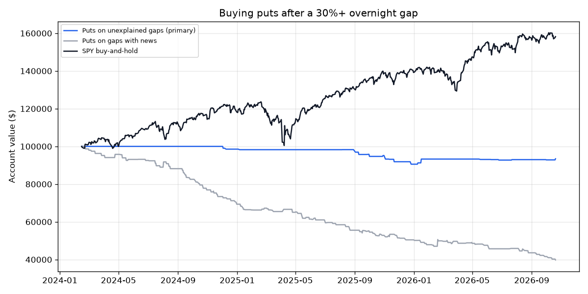

# Buy Puts on Unexplained Overnight Gaps — 2026-10-21

*Paper research only; not investment advice. Rules: [gap_puts_preregistration.md](gap_puts_preregistration.md), committed before any data was fetched.*

## Verdict: **NO-GO** (3 of 9 bars passed)

| Bar | Result | Detail |
|---|---|---|
| 1 · Data check | PASS | no problems |
| 2 · Enough trades (≥ 50) | **FAIL** | 24 trades |
| 3 · Makes money after costs | **FAIL** | total -6.6%, average trade -21.8% of premium |
| 4 · Not luck (t-stat ≥ 2) | **FAIL** | t = -1.75 |
| 5 · Worth the risk (Sharpe ≥ SPY) | **FAIL** | -0.91 vs 1.18 |
| 6 · Survivable (worst drop ≤ 25%) | PASS | 9.4% |
| 7 · Survives double spreads | **FAIL** | total -9.0% |
| 8 · Not fragile (t+1 and t+10 exits average > 0) | **FAIL** | t+1: avg -18.3% (25 trades); t+10: avg -24.1% (23 trades) |
| 9 · News filter matters (unexplained beats with-news) | PASS | -21.8% vs -36.9% |

## The funnel (2024-02-15 to 2026-10-20, gaps of +30% or more)

| | Gaps | No listed put | Put didn't trade 9:45–10:30 | Tradeable |
|---|---|---|---|---|
| Unexplained (no news) | 195 | 146 | 23 | 26 |
| With news | 480 | 112 | 108 | 260 |

## Results (returns are % of the premium paid, after costs)

| | Trades | Winners | Average | Median | t-stat | Total | Annual | Worst drop | Sharpe |
|---|---|---|---|---|---|---|---|---|---|
| **Unexplained gaps, hold to t+5 (primary)** | 24 | 33% | -21.8% | -17.2% | -1.75 | -6.6% | -2.5% | 9.4% | -0.91 |
| Primary, double spreads | 24 | 25% | -29.0% | -25.2% | -2.56 | -9.0% | -3.5% | 10.6% | -1.28 |
| Primary, no spreads (reference) | 24 | 42% | -13.9% | -8.5% | -1.02 | -4.3% | -1.6% | 8.4% | -0.55 |
| Gaps with news | 177 | 22% | -36.9% | -60.5% | -6.48 | -60.2% | -29.1% | 60.2% | -3.49 |
| Unexplained, exit t+1 | 25 | 20% | -18.3% | -16.0% | -2.95 | -5.8% | -2.2% | 6.6% | -1.41 |
| Unexplained, exit t+10 | 23 | 35% | -24.1% | -42.0% | -1.59 | -7.3% | -2.8% | 9.8% | -0.90 |
| Unexplained, gap ≥ +20% | 65 | 23% | -42.4% | -55.2% | -6.37 | -32.7% | -13.7% | 33.1% | -3.02 |
| Unexplained, gap ≥ +50% | 6 | 67% | +17.7% | +9.4% | 0.54 | +1.6% | +0.6% | 1.4% | 0.35 |
| SPY buy-and-hold | — | — | — | — | — | +58.2% | +18.7% | 18.8% | 1.18 |

**Context — what the stock itself did** (a short from the gap-day open, no costs, no borrow limits; positive = the stock fell):

| | Gaps | Avg to t+1 close | Median | Avg to t+5 close | Median | Avg to t+10 close | Median |
|---|---|---|---|---|---|---|---|
| Unexplained | 195 | +3.2% | +12.7% | -0.6% | +21.8% | +11.6% | +26.7% |
| With news | 480 | +2.9% | +4.0% | +3.9% | +4.4% | +3.0% | +5.7% |

## Primary: 10 best and 10 worst trades

| Day | Symbol | Gap | Put | Contracts | Paid | Back | Return |
|---|---|---|---|---|---|---|---|
| 2026-01-09 | OPAD | +53% | OPAD260116P00002500 | 32 | $1,329 | $3,354 | +152% |
| 2026-01-02 | IRWD | +36% | IRWD260116P00005000 | 22 | $1,353 | $2,042 | +51% |
| 2026-10-14 | GLND | +87% | GLND261023P00004000 | 22 | $1,385 | $1,966 | +42% |
| 2025-10-22 | FLWS | +32% | FLWS251121P00007000 | 5 | $1,209 | $1,664 | +38% |
| 2026-07-15 | ELVA | +55% | ELVA260821P00012500 | 5 | $1,387 | $1,616 | +17% |
| 2025-09-02 | MNKD | +32% | MNKD250912P00006000 | 35 | $1,449 | $1,607 | +11% |
| 2025-09-22 | ARBE | +37% | ARBE251017P00002000 | 36 | $1,427 | $1,516 | +6% |
| 2025-07-30 | REPL | +71% | REPL250808P00006500 | 18 | $1,451 | $1,482 | +2% |
| 2026-06-02 | VSXY | +45% | VSXY260618P00080000 | 2 | $1,277 | $1,192 | -7% |
| 2025-11-04 | NFE | +31% | NFE251114P00001500 | 40 | $1,390 | $1,287 | -7% |
| 2024-12-27 | SLDP | +37% | SLDP250117P00002500 | 20 | $1,436 | $1,156 | -20% |
| 2026-05-11 | MRAM | +34% | MRAM260618P00035000 | 1 | $815 | $613 | -25% |
| 2025-10-27 | BMA | +39% | BMA251121P00080000 | 1 | $804 | $195 | -76% |
| 2025-09-24 | CLPT | +34% | CLPT251017P00017500 | 10 | $1,414 | $303 | -79% |
| 2024-11-25 | SRRK | +34% | SRRK241220P00040000 | 3 | $1,145 | $175 | -85% |
| 2025-08-25 | OPAD | +32% | OPAD250919P00002500 | 19 | $1,440 | $96 | -93% |
| 2025-09-02 | MLYS | +46% | MLYS250919P00022500 | 17 | $1,450 | $70 | -95% |
| 2025-11-14 | IVVD | +45% | IVVD251121P00002500 | 27 | $1,354 | $59 | -96% |
| 2025-12-18 | SOC | +52% | SOC251226P00008000 | 22 | $1,361 | $60 | -96% |
| 2025-10-27 | BBAR | +44% | BBAR251121P00015000 | 7 | $1,280 | $0 | -100% |

Every gap with its news, put and prices: [gap_puts_candidates.csv](gap_puts_candidates.csv). Classifier sample: [gap_puts_classifier_sample.md](gap_puts_classifier_sample.md).

## Limits (from the rules, section G)

- About 2.7 years of option history only.
- Bid/ask spreads are modelled (5% each side), not measured.
- The news filter sees only Benzinga's coverage and uses a keyword rule.
- Fills assume $1,500 of puts could be bought near the 9:45–10:30 average price.
