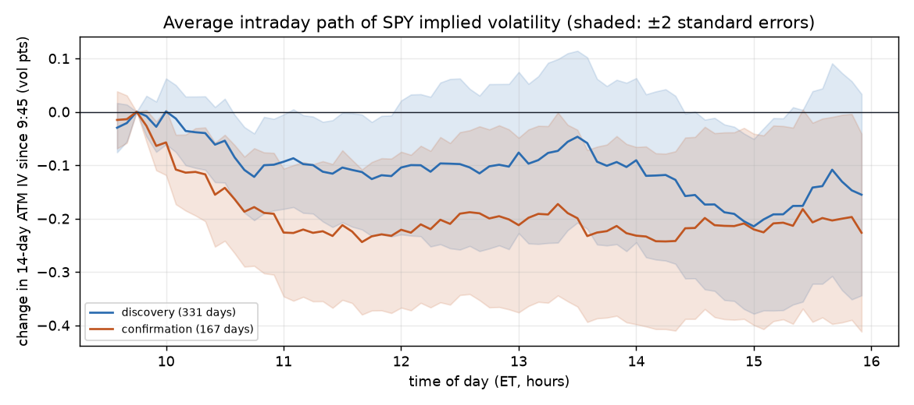

# Intraday volatility-pattern study — 2024-10-21 to 2026-10-16

Real SPY option quotes (Databento OPRA consolidated best bid/offer, 1-minute), 499 trading days. Discovery = days before 2026-02-19; confirmation = 2026-02-19 onward (never used to pick anything). Research only — no trading rule has been changed.

> **Bottom line.** No entry/exit combination made money after real bid/ask costs in both periods (0 of 80 looked significant in discovery alone; by chance alone roughly 2 would). The intraday pattern, if any, is smaller than the cost of trading it with these structures.

## 1. How implied volatility moves during the day

Average change in 14-day at-the-money implied volatility since 9:45 ET, in vol points:

| Period | 10:30 | 12:00 | 13:00 | 14:00 | 15:00 | 15:30 | 15:55 |
|---|---:|---:|---:|---:|---:|---:|---:|
| discovery | -0.05 (±0.08) | -0.10 (±0.13) | -0.08 (±0.15) | -0.09 (±0.15) | -0.21 (±0.16) | -0.14 (±0.18) | -0.16 (±0.19) |
| confirmation | -0.14 (±0.10) | -0.22 (±0.15) | -0.21 (±0.16) | -0.23 (±0.17) | -0.22 (±0.18) | -0.21 (±0.19) | -0.23 (±0.19) |

A curve that drifts the same way in both periods, with its shaded band clear of zero, is a real tendency. Whether it pays depends on section 2. Note: implied vol here uses calendar time, which counts the hours after the close; that alone pushes measured IV slightly up through the day, so a gentle rise is partly a measurement effect.

## 2. Could you have traded it? Iron butterflies at real bid/ask

Short fly = sell the at-the-money call and put, buy wings $5 or $20 away (profits if options lose value). Long fly = the reverse. Nearest expiry at least 7 days out. Entered and exited at executable prices, $0.40 fees per round trip, per 1 fly ($ per contract set). *Gross* is the short fly at mid prices, before costs.

| Wings | Entry → exit | Side | Discovery n | Mean $ | t | Confirmation n | Mean $ | t | Gross (mid) $ | Holds in both? |
|---:|---|---|---:|---:|---:|---:|---:|---:|---:|:---:|
| $5 | 09:45 → 10:30 | short | 318 | -31.91 | -9.3 | 161 | -25.72 | -7.6 | +0.32 | – |
| $5 | 09:45 → 10:30 | long | 318 | -32.77 | -9.6 | 161 | -25.92 | -8.4 | +0.32 | – |
| $5 | 09:45 → 12:00 | short | 318 | -31.03 | -9.1 | 161 | -27.20 | -8.0 | +0.33 | – |
| $5 | 09:45 → 12:00 | long | 318 | -32.15 | -9.6 | 161 | -26.93 | -8.6 | +0.33 | – |
| $5 | 09:45 → 13:00 | short | 318 | -32.02 | -9.4 | 161 | -27.83 | -8.0 | +0.39 | – |
| $5 | 09:45 → 13:00 | long | 318 | -33.57 | -9.9 | 161 | -27.12 | -8.7 | +0.39 | – |
| $5 | 09:45 → 14:00 | short | 313 | -45.02 | -8.9 | 161 | -37.19 | -7.9 | +0.32 | – |
| $5 | 09:45 → 14:00 | long | 313 | -46.81 | -8.8 | 161 | -35.57 | -7.9 | +0.32 | – |
| $5 | 09:45 → 15:00 | short | 313 | -33.12 | -9.5 | 161 | -29.62 | -8.7 | -0.28 | – |
| $5 | 09:45 → 15:00 | long | 313 | -33.23 | -10.0 | 161 | -27.73 | -8.9 | -0.28 | – |
| $5 | 09:45 → 15:30 | short | 313 | -32.70 | -9.5 | 161 | -29.56 | -8.5 | -0.23 | – |
| $5 | 09:45 → 15:30 | long | 313 | -33.12 | -10.0 | 161 | -27.41 | -8.8 | -0.23 | – |
| $5 | 10:30 → 12:00 | short | 319 | -15.64 | -19.4 | 161 | -17.52 | -23.0 | +0.50 | – |
| $5 | 10:30 → 12:00 | long | 319 | -17.19 | -18.3 | 161 | -17.44 | -25.6 | +0.50 | – |
| $5 | 10:30 → 13:00 | short | 319 | -16.95 | -15.2 | 161 | -18.11 | -22.7 | +0.19 | – |
| $5 | 10:30 → 13:00 | long | 319 | -18.01 | -16.8 | 161 | -17.12 | -26.3 | +0.19 | – |
| $5 | 10:30 → 14:00 | short | 314 | -30.94 | -7.6 | 161 | -27.44 | -7.6 | +0.04 | – |
| $5 | 10:30 → 14:00 | long | 314 | -32.33 | -7.9 | 161 | -24.95 | -7.3 | +0.04 | – |
| $5 | 10:30 → 15:00 | short | 314 | -18.36 | -16.4 | 161 | -20.23 | -21.5 | -0.19 | – |
| $5 | 10:30 → 15:00 | long | 314 | -18.74 | -19.3 | 161 | -18.36 | -21.9 | -0.19 | – |
| $5 | 10:30 → 15:30 | short | 314 | -17.90 | -16.9 | 161 | -20.41 | -19.3 | -0.36 | – |
| $5 | 10:30 → 15:30 | long | 314 | -17.82 | -19.3 | 161 | -18.42 | -21.1 | -0.36 | – |
| $5 | 12:00 → 13:00 | short | 320 | -16.46 | -15.2 | 162 | -15.71 | -27.5 | -0.07 | – |
| $5 | 12:00 → 13:00 | long | 320 | -16.52 | -15.2 | 162 | -15.17 | -28.5 | -0.07 | – |
| $5 | 12:00 → 14:00 | short | 315 | -30.35 | -7.6 | 162 | -25.43 | -7.0 | -0.05 | – |
| $5 | 12:00 → 14:00 | long | 315 | -30.48 | -7.6 | 162 | -24.86 | -6.6 | -0.05 | – |
| $5 | 12:00 → 15:00 | short | 315 | -18.94 | -13.3 | 162 | -19.46 | -19.0 | -0.88 | – |
| $5 | 12:00 → 15:00 | long | 315 | -17.42 | -17.5 | 162 | -17.26 | -22.6 | -0.88 | – |
| $5 | 12:00 → 15:30 | short | 315 | -18.58 | -13.6 | 162 | -18.59 | -20.6 | -0.60 | – |
| $5 | 12:00 → 15:30 | long | 315 | -17.35 | -15.4 | 162 | -17.45 | -21.0 | -0.60 | – |
| $5 | 13:00 → 14:00 | short | 312 | -32.58 | -7.1 | 161 | -24.21 | -6.9 | +0.34 | – |
| $5 | 13:00 → 14:00 | long | 312 | -33.73 | -6.8 | 161 | -23.98 | -6.7 | +0.34 | – |
| $5 | 13:00 → 15:00 | short | 312 | -18.29 | -12.8 | 161 | -17.17 | -22.7 | -0.60 | – |
| $5 | 13:00 → 15:00 | long | 312 | -17.10 | -16.8 | 161 | -15.95 | -25.3 | -0.60 | – |
| $5 | 13:00 → 15:30 | short | 312 | -17.95 | -14.0 | 161 | -16.65 | -21.1 | -0.37 | – |
| $5 | 13:00 → 15:30 | long | 312 | -17.01 | -15.3 | 161 | -16.31 | -24.0 | -0.37 | – |
| $5 | 14:00 → 15:00 | short | 313 | -29.93 | -7.5 | 161 | -24.52 | -6.2 | -0.01 | – |
| $5 | 14:00 → 15:00 | long | 313 | -30.33 | -7.4 | 161 | -23.65 | -6.0 | -0.01 | – |
| $5 | 14:00 → 15:30 | short | 313 | -29.64 | -7.8 | 161 | -24.58 | -6.0 | +0.14 | – |
| $5 | 14:00 → 15:30 | long | 313 | -30.20 | -7.5 | 161 | -24.33 | -6.0 | +0.14 | – |
| $20 | 09:45 → 10:30 | short | 118 | -25.47 | -6.6 | 103 | -13.45 | -5.0 | +0.63 | – |
| $20 | 09:45 → 10:30 | long | 118 | -21.09 | -5.8 | 103 | -21.17 | -8.0 | +0.63 | – |
| $20 | 09:45 → 12:00 | short | 116 | -19.65 | -4.2 | 103 | -12.66 | -3.0 | +4.03 | – |
| $20 | 09:45 → 12:00 | long | 116 | -25.81 | -6.2 | 103 | -22.85 | -6.2 | +4.03 | – |
| $20 | 09:45 → 13:00 | short | 118 | -21.59 | -4.1 | 103 | -16.89 | -3.4 | +1.75 | – |
| $20 | 09:45 → 13:00 | long | 118 | -25.70 | -5.5 | 103 | -19.68 | -4.2 | +1.75 | – |
| $20 | 09:45 → 14:00 | short | 110 | -19.94 | -3.3 | 102 | -23.74 | -3.7 | +2.20 | – |
| $20 | 09:45 → 14:00 | long | 110 | -27.15 | -5.1 | 102 | -25.10 | -3.9 | +2.20 | – |
| $20 | 09:45 → 15:00 | short | 117 | -23.42 | -3.4 | 103 | -22.72 | -3.6 | -0.24 | – |
| $20 | 09:45 → 15:00 | long | 117 | -27.67 | -5.0 | 103 | -16.86 | -2.8 | -0.24 | – |
| $20 | 09:45 → 15:30 | short | 117 | -28.94 | -3.7 | 103 | -23.03 | -3.4 | -3.76 | – |
| $20 | 09:45 → 15:30 | long | 117 | -21.85 | -3.4 | 103 | -15.02 | -2.4 | -3.76 | – |
| $20 | 10:30 → 12:00 | short | 121 | -11.54 | -4.8 | 109 | -12.17 | -4.3 | +2.48 | – |
| $20 | 10:30 → 12:00 | long | 121 | -18.81 | -8.5 | 109 | -14.58 | -5.7 | +2.48 | – |
| $20 | 10:30 → 13:00 | short | 122 | -17.47 | -5.1 | 109 | -14.64 | -4.2 | -0.70 | – |
| $20 | 10:30 → 13:00 | long | 122 | -16.06 | -5.5 | 109 | -13.26 | -4.3 | -0.70 | – |
| $20 | 10:30 → 14:00 | short | 118 | -16.45 | -4.5 | 108 | -21.18 | -4.3 | +0.27 | – |
| $20 | 10:30 → 14:00 | long | 118 | -18.65 | -4.3 | 108 | -19.90 | -4.1 | +0.27 | – |
| $20 | 10:30 → 15:00 | short | 122 | -19.23 | -3.6 | 109 | -17.24 | -4.1 | -1.55 | – |
| $20 | 10:30 → 15:00 | long | 122 | -16.63 | -3.9 | 109 | -13.57 | -3.4 | -1.55 | – |
| $20 | 10:30 → 15:30 | short | 122 | -21.91 | -3.4 | 109 | -16.91 | -3.7 | -3.28 | – |
| $20 | 10:30 → 15:30 | long | 122 | -12.08 | -2.3 | 109 | -14.01 | -3.4 | -3.28 | – |
| $20 | 12:00 → 13:00 | short | 120 | -17.60 | -9.0 | 104 | -14.04 | -7.8 | -2.00 | – |
| $20 | 12:00 → 13:00 | long | 120 | -13.32 | -7.0 | 104 | -10.35 | -6.1 | -2.00 | – |
| $20 | 12:00 → 14:00 | short | 117 | -25.46 | -4.0 | 103 | -24.32 | -5.2 | -2.22 | – |
| $20 | 12:00 → 14:00 | long | 117 | -19.75 | -3.8 | 103 | -21.32 | -4.5 | -2.22 | – |
| $20 | 12:00 → 15:00 | short | 119 | -24.78 | -4.0 | 104 | -19.15 | -6.1 | -5.10 | – |
| $20 | 12:00 → 15:00 | long | 119 | -12.81 | -2.9 | 104 | -10.98 | -3.8 | -5.10 | – |
| $20 | 12:00 → 15:30 | short | 120 | -28.28 | -3.9 | 104 | -18.58 | -5.4 | -7.24 | – |
| $20 | 12:00 → 15:30 | long | 120 | -8.27 | -1.4 | 104 | -10.49 | -3.5 | -7.24 | – |
| $20 | 13:00 → 14:00 | short | 108 | -14.17 | -6.7 | 96 | -22.67 | -4.9 | -0.07 | – |
| $20 | 13:00 → 14:00 | long | 108 | -15.06 | -7.8 | 96 | -21.39 | -4.9 | -0.07 | – |
| $20 | 13:00 → 15:00 | short | 112 | -20.84 | -3.4 | 97 | -14.81 | -5.9 | -1.83 | – |
| $20 | 13:00 → 15:00 | long | 112 | -16.10 | -3.8 | 97 | -12.38 | -5.8 | -1.83 | – |
| $20 | 13:00 → 15:30 | short | 113 | -24.43 | -3.4 | 97 | -13.51 | -4.7 | -3.79 | – |
| $20 | 13:00 → 15:30 | long | 113 | -11.28 | -1.9 | 97 | -12.41 | -5.0 | -3.79 | – |
| $20 | 14:00 → 15:00 | short | 111 | -11.62 | -6.3 | 96 | -24.90 | -4.8 | +0.29 | – |
| $20 | 14:00 → 15:00 | long | 111 | -16.08 | -9.2 | 96 | -20.98 | -4.2 | +0.29 | – |
| $20 | 14:00 → 15:30 | short | 111 | -15.64 | -7.2 | 96 | -23.58 | -4.3 | -0.71 | – |
| $20 | 14:00 → 15:30 | long | 111 | -14.11 | -6.7 | 96 | -22.30 | -4.5 | -0.71 | – |

Typical round-trip cost of one fly (bid-ask paid on 4 legs, twice, plus fees): about $13.90 with $5 wings, about $11.90 with $20 wings. A pattern has to move option prices by more than that to be worth trading.

## 3. Notes and limits

* Data: 499 days so far. Each additional month of history makes these estimates firmer; the study is re-run with `main.py vol-study` as more data arrives.
* A t-statistic above 2 in both periods is the bar. Testing many combinations means a few will clear 2 in one period by luck; requiring both periods guards against that.
* Short flies lose on large SPY moves (they are short gamma). Their results are always shown at executable prices so this risk is fully in the numbers.
* The no-overnight rule is respected in sections 1–2: every trade opens and closes the same day.

## 4. Outside the current rules: holding overnight or for several days

**Research only.** The current risk limits forbid overnight positions; nothing here changes that. It shows whether longer holds change the cost picture, so the owner can decide with real numbers. Same iron butterflies, real bid/ask, expiry still at least 8 days out when closed. Per fly; the most one can lose is the wing width × 100 ($500 or $2,000).

| Wings | Hold | Side | Discovery n | Mean $ | t | Win % | Confirmation n | Mean $ | t | Win % |
|---:|---|---|---:|---:|---:|---:|---:|---:|---:|---:|
| $5 | overnight | short | 304 | -19.30 | -14.5 | 3% | 160 | -18.99 | -17.4 | 3% |
| $5 | overnight | long | 304 | -20.13 | -13.8 | 6% | 160 | -23.52 | -24.5 | 1% |
| $5 | 1 day | short | 305 | -19.37 | -15.3 | 6% | 160 | -20.78 | -16.0 | 1% |
| $5 | 1 day | long | 305 | -21.14 | -16.0 | 6% | 160 | -24.38 | -27.5 | 0% |
| $5 | 3 days | short | 270 | -23.93 | -14.2 | 16% | 140 | -23.18 | -13.0 | 6% |
| $5 | 3 days | long | 270 | -26.80 | -16.4 | 10% | 140 | -35.55 | -15.3 | 2% |
| $5 | 5 days | short | 311 | -24.81 | -14.6 | 17% | 155 | -24.94 | -14.7 | 13% |
| $5 | 5 days | long | 311 | -29.41 | -16.0 | 11% | 155 | -37.34 | -19.0 | 2% |
| $20 | overnight | short | 106 | -19.94 | -3.1 | 42% | 97 | -4.69 | -0.8 | 57% |
| $20 | overnight | long | 106 | -19.29 | -3.3 | 23% | 97 | -29.78 | -5.4 | 18% |
| $20 | 1 day | short | 111 | -30.11 | -3.0 | 50% | 106 | +0.84 | +0.1 | 63% |
| $20 | 1 day | long | 111 | -8.54 | -0.9 | 35% | 106 | -36.92 | -4.7 | 18% |
| $20 | 3 days | short | 92 | -24.69 | -1.5 | 57% | 97 | +33.71 | +2.0 | 70% |
| $20 | 3 days | long | 92 | -26.85 | -1.8 | 34% | 97 | -81.52 | -5.4 | 23% |
| $20 | 5 days | short | 113 | -50.56 | -2.8 | 45% | 106 | +35.11 | +2.0 | 72% |
| $20 | 5 days | long | 113 | -5.09 | -0.3 | 41% | 106 | -86.70 | -5.1 | 24% |

**Positive after costs with t > 2 in both periods:** none.

Holds of several days overlap (a 5-day hold starts every day), so their t-statistics overstate certainty somewhat. Short flies carry crash risk that a few months of data may not contain.

### 4a. Crash test: $20-wing short fly held 5 days

219 trades from 2024-10-21 to 2026-10-09; 115 closed with at least one leg outside the downloaded strikes, priced from the nearest real quotes (see `_estimate_leg`). Most one fly can lose: about $2,000 minus the credit.

* Mean $-9.10, t -0.7, win rate 58%, average credit $1289
* Worst trade $-575.40; worst 5 trades below

| Opened | Closed | SPY in | SPY out | Move | Credit $ | P&L $ | A leg estimated |
|---|---|---:|---:|---:|---:|---:|---|
| 2024-12-13 | 2024-12-20 | 605.02 | 586.98 | -3.0% | 835 | -575.40 | yes |
| 2026-07-29 | 2026-08-05 | 734.92 | 774.78 | +5.4% | 1430 | -522.73 | yes |
| 2026-07-31 | 2026-08-07 | 740.49 | 773.19 | +4.4% | 1397 | -482.31 | yes |
| 2025-01-14 | 2025-01-22 | 583.15 | 606.69 | +4.0% | 1291 | -480.40 | no |
| 2025-04-02 | 2025-04-09 | 560.86 | 498.98 | -11.0% | 1408 | -473.15 | yes |

**Spring 2025 (opened 2025-03-17 to 2025-05-16, includes the April tariff crash):** 30 trades, mean $-126.50, total $-3,794.88, worst $-473.15, win rate 30%.

One position at a time (close and reopen every ~5 trading days), one fly, five possible start days:

| Starts | Trades | Total $ | Worst trade $ | Max drawdown $ | Drawdown % of $100k | Losing trades |
|---|---:|---:|---:|---:|---:|---:|
| 2024-10-21 | 69 | -1,453 | -482 | -2,090 | -2.1% | 31 |
| 2024-10-22 | 69 | -1,463 | -482 | -2,090 | -2.1% | 31 |
| 2024-10-23 | 69 | -1,901 | -482 | -2,459 | -2.5% | 31 |
| 2024-10-29 | 68 | -1,435 | -482 | -2,090 | -2.1% | 30 |
| 2024-10-31 | 68 | -1,906 | -482 | -2,459 | -2.5% | 31 |

No stop loss is applied here: each trade is held the full period, so these are the unmanaged numbers.
