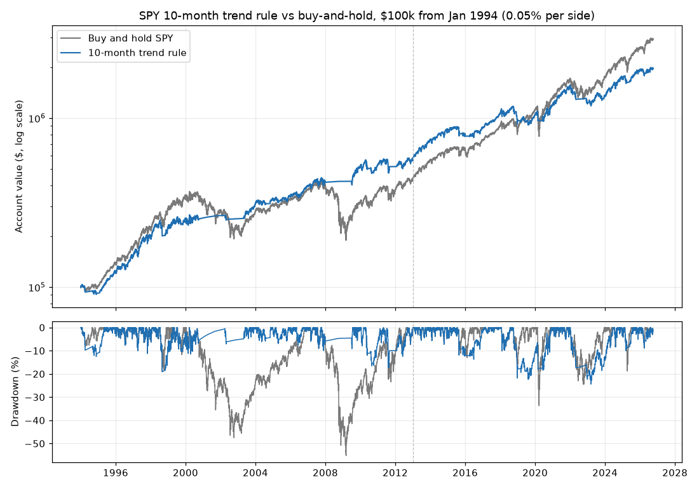

# SPY Monthly Trend (10-Month Average) Backtest — 2026-10-20

*Paper research only; not investment advice. Rules: [monthly_trend_preregistration.md](monthly_trend_preregistration.md), committed before this ran.*

## Verdict: **NO-GO** (6 of 7 bars passed)

| Bar | Result | Detail |
|---|---|---|
| 1 · Log check | PASS | 49 trades, 0 problems |
| 2 · Sharpe ≥ buy-and-hold (full) | PASS | 0.68 vs 0.61 |
| 3 · Max drawdown ≤ 0.6 × buy-and-hold (full) | PASS | 24.4% vs limit 33.1% (buy-and-hold 55.2%) |
| 4 · CAGR ≥ buy-and-hold − 2 pp (full) | PASS | 9.51% vs 10.85% |
| 5 · Confirmation: Sharpe ≥ and drawdown < buy-and-hold | **FAIL** | Sharpe 0.71 vs 0.93; drawdown 24.4% vs 33.7% |
| 6 · 9 and 11 months pass bars 2 and 3 | PASS | 9 mo: Sharpe 0.69, drawdown 24.4% (pass); 11 mo: Sharpe 0.70, drawdown 22.3% (pass) |
| 7 · At 0.25% per side, Sharpe ≥ buy-and-hold | PASS | 0.65 vs 0.61 |

## Results at 0.05% per side

**Full period: 1994-01-01 to 2026-09-30**

| | Total return | Annual (CAGR) | Max drawdown | Worst year | Sharpe | Trades | Time invested |
|---|---|---|---|---|---|---|---|
| 10-month rule | +1,858% | 9.51% | 24.4% | 2022 (-20.7%) | 0.68 | 49 | 76% |
| Buy and hold | +2,817% | 10.85% | 55.2% | 2008 (-36.8%) | 0.61 | 1 | 100% |

**Discovery: 1994-01-01 to 2012-12-31**

| | Total return | Annual (CAGR) | Max drawdown | Worst year | Sharpe | Trades | Time invested |
|---|---|---|---|---|---|---|---|
| 10-month rule | +468% | 9.57% | 19.0% | 1994 (-7.8%) | 0.66 | 25 | 69% |
| Buy and hold | +331% | 8.00% | 55.2% | 2008 (-36.8%) | 0.39 | 1 | 100% |

**Confirmation: 2013-01-01 to 2026-09-30**

| | Total return | Annual (CAGR) | Max drawdown | Worst year | Sharpe | Trades | Time invested |
|---|---|---|---|---|---|---|---|
| 10-month rule | +245% | 9.42% | 24.4% | 2022 (-20.7%) | 0.71 | 24 | 85% |
| Buy and hold | +577% | 14.92% | 33.7% | 2022 (-18.2%) | 0.93 | 0 | 100% |

## Lookbacks (full period)

| | Total return | Annual (CAGR) | Max drawdown | Worst year | Sharpe | Trades | Time invested |
|---|---|---|---|---|---|---|---|
| 8 months (info only) | +1,911% | 9.60% | 24.4% | 2022 (-20.7%) | 0.70 | 61 | 73% |
| 9 months (bar 6) | +1,855% | 9.51% | 24.4% | 2022 (-20.7%) | 0.69 | 55 | 74% |
| 10 months (main) | +1,858% | 9.51% | 24.4% | 2022 (-20.7%) | 0.68 | 49 | 76% |
| 11 months (bar 6) | +1,961% | 9.68% | 22.3% | 2022 (-15.3%) | 0.70 | 43 | 76% |
| 12 months (info only) | +2,155% | 9.98% | 22.3% | 2022 (-15.3%) | 0.72 | 41 | 77% |
| Buy and hold | +2,817% | 10.85% | 55.2% | 2008 (-36.8%) | 0.61 | 1 | 100% |

## Trading costs (full period)

| Cost per side | Rule CAGR | Rule Sharpe | Buy-and-hold CAGR | Buy-and-hold Sharpe | Total cost paid by rule |
|---|---|---|---|---|---|
| 0.00% | 9.59% | 0.69 | 10.85% | 0.61 | $0 |
| 0.05% | 9.51% | 0.68 | 10.85% | 0.61 | $18,042 |
| 0.10% | 9.43% | 0.67 | 10.85% | 0.61 | $35,487 |
| 0.25% | 9.18% | 0.65 | 10.85% | 0.61 | $84,394 |

## Trades

- 49 trades (24 completed holding periods, 1 still open). Winners 15, losers 9.
- Whipsaws (held 62 days or less and lost): 5; their returns add up to -37.0%.
- Full trade log: [monthly_trend_trades.csv](monthly_trend_trades.csv). Monthly log (close, average, signal, intended trade, fill): [monthly_trend_log.csv](monthly_trend_log.csv).

| Bought | Sold | Return incl. costs |
|---|---|---|
| 1994-01-03 | 1994-04-04 | -6.5% |
| 1994-09-01 | 1994-12-01 | -3.4% |
| 1995-02-01 | 1998-09-01 | +116.9% |
| 1998-11-02 | 1999-10-01 | +16.7% |
| 1999-11-01 | 2000-10-02 | +6.6% |
| 2002-04-01 | 2002-05-01 | -5.6% |
| 2003-05-01 | 2004-08-02 | +22.1% |
| 2004-11-01 | 2005-05-02 | +3.3% |
| 2005-06-01 | 2008-01-02 | +28.8% |
| 2009-07-01 | 2010-06-01 | +18.9% |
| 2010-08-02 | 2010-09-01 | -4.8% |
| 2010-10-01 | 2011-09-01 | +7.8% |
| 2012-02-01 | 2015-09-01 | +56.5% |
| 2015-11-02 | 2016-01-04 | -3.3% |
| 2016-04-01 | 2018-11-01 | +39.4% |
| 2018-12-03 | 2019-01-02 | -11.8% |
| 2019-03-01 | 2019-06-03 | -1.5% |
| 2019-07-01 | 2020-03-02 | +1.4% |
| 2020-06-01 | 2022-03-01 | +46.9% |
| 2022-04-01 | 2022-05-02 | -9.2% |
| 2022-12-01 | 2023-01-03 | -5.6% |
| 2023-02-01 | 2023-11-01 | +4.5% |
| 2023-12-01 | 2025-04-01 | +24.6% |
| 2025-06-02 | 2026-04-01 | +12.4% |
| 2026-05-01 | still held | – |

## Data checks

- SPY daily bars: 8,475 days, 1993-01-29 to 2026-09-30 (Yahoo Finance, free). Last complete month used: September 2026.
- Yahoo close vs our stored minute bars: 2,714 days compared (2016-01-04 to 2026-10-19), median gap 0.008%, 4 day(s) off by more than 0.5%: 2018-12-24 (0.54%), 2020-03-13 (0.60%), 2020-03-17 (0.55%), 2025-04-09 (0.96%).
- Dividends 1994–2026: 132. Years without exactly 4: 2004 (5). Off SPY's schedule: 2004-11-15.
- Cash earns FRED DTB3 (3-month T-bill), using the rate published before each day.
- Taxes are ignored. They'd hurt the rule more than buy-and-hold, because the rule sells and realizes gains.

## Reading the result (review notes, written after the run)

- **What it did well.** Over 1994–2026 it cut the worst drop from 55% to 24% and had a better return per unit of
  risk (Sharpe 0.68 vs 0.61), for about 1.3 percentage points a year less return. Nearby lookbacks (8–12 months)
  tell the same story, and costs barely matter (49 trades in 33 years). Almost all of that edge came from
  **two events**: it was in cash for most of the 2000–02 and 2008–09 crashes.
- **Why it fails.** In 2013–2026 (the later check, never used to set anything) it earned 9.4% a year against
  14.9% for simply holding, with a lower Sharpe (0.71 vs 0.93). Its drawdown was smaller (24% vs 34%) but not by
  much. The market's drops in this period were fast (Dec 2018, Mar 2020) or choppy (2022), which is exactly
  what a once-a-month rule handles badly: it sold after the fall and bought back higher. In 2022 it lost *more*
  than holding (−20.7% vs −18.2%) because of two whipsaws.
- **Honest summary.** The rule works as insurance against long, slow bear markets, and it has paid for that
  insurance in every other kind of market. Whether 2000–09-style bear markets come back can't be known from
  this data, which is why the pre-registered later-period bar exists. It failed that bar.
- **Data notes.** The 2004 extra dividend (ex-date 2004-11-15) is real: it passed through Microsoft's one-time
  special dividend. The four days where Yahoo and our minute bars differ by 0.5–1% are all very fast market days
  where the last minute bar and the official close differ; none is a month-end, so no signal is affected.
