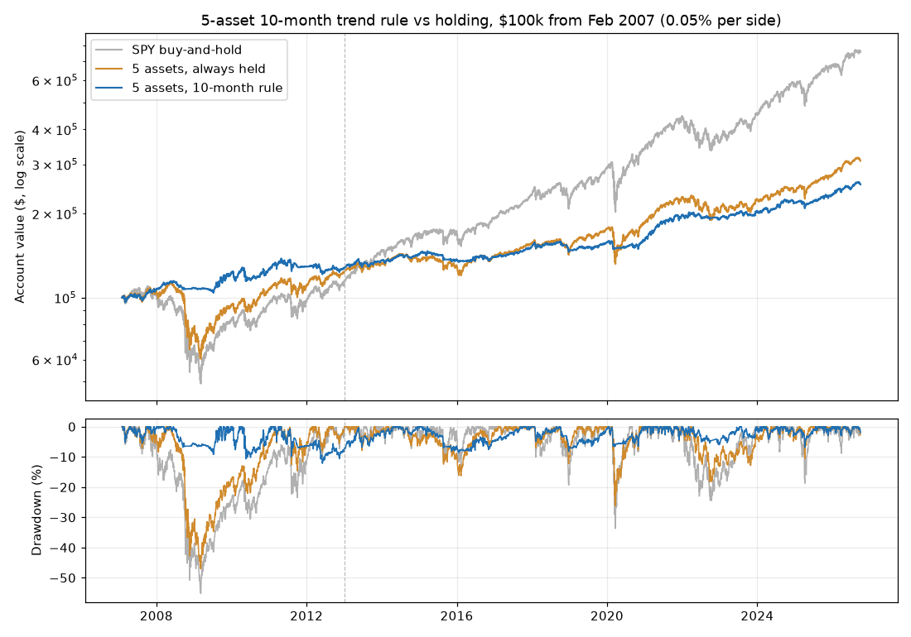

# Multi-Asset Monthly Trend (Faber's 5 Asset Classes) Backtest — 2026-10-20

*Paper research only; not investment advice. Rules: [multi_asset_trend_preregistration.md](multi_asset_trend_preregistration.md), committed before this ran.*

## Verdict: **NO-GO** (7 of 8 bars passed)

| Bar | Result | Detail |
|---|---|---|
| 1 · Log check | PASS | 812 trades over 237 month-ends, 0 problems |
| 2 · Sharpe ≥ equal-weight hold (full) | PASS | 0.54 vs 0.41 |
| 3 · Max drawdown ≤ 0.6 × equal-weight hold (full) | PASS | 12.2% vs limit 28.2% (hold 47.0%) |
| 4 · CAGR ≥ equal-weight hold − 2 pp (full) | PASS | 4.86% vs 5.90% |
| 5 · Confirmation: Sharpe ≥ and drawdown < equal-weight hold | PASS | Sharpe 0.59 vs 0.54; drawdown 8.6% vs 26.2% |
| 6 · 9 and 11 months pass bars 2 and 3 | PASS | 9 mo: Sharpe 0.53, drawdown 11.6% (pass); 11 mo: Sharpe 0.49, drawdown 12.6% (pass) |
| 7 · At 0.25% per side, Sharpe ≥ equal-weight hold | PASS | 0.48 vs 0.40 |
| 8 · vs SPY: Sharpe ≥ and drawdown ≤ 0.6 × SPY's (full) | **FAIL** | Sharpe 0.54 vs 0.65; drawdown 12.2% vs limit 33.1% (SPY 55.2%) |

## Results at 0.05% per side

**Full period: 2007-02-01 to 2026-09-30**

| | Total return | Annual (CAGR) | Max drawdown | Worst year | Sharpe | Trades | Time invested |
|---|---|---|---|---|---|---|---|
| 5 assets, 10-month rule | +154% | 4.86% | 12.2% | 2015 (-4.2%) | 0.54 | 812 | 61% |
| 5 assets, always held | +209% | 5.90% | 47.0% | 2008 (-26.1%) | 0.41 | 1180 | 100% |
| SPY buy-and-hold | +658% | 10.86% | 55.2% | 2008 (-36.8%) | 0.65 | 1 | 100% |

**Discovery: 2007-02-01 to 2012-12-31**

| | Total return | Annual (CAGR) | Max drawdown | Worst year | Sharpe | Trades | Time invested |
|---|---|---|---|---|---|---|---|
| 5 assets, 10-month rule | +27% | 4.17% | 12.2% | 2012 (-1.5%) | 0.46 | 246 | 62% |
| 5 assets, always held | +23% | 3.61% | 47.0% | 2008 (-26.1%) | 0.24 | 355 | 100% |
| SPY buy-and-hold | +12% | 1.95% | 55.2% | 2008 (-36.8%) | 0.14 | 1 | 100% |

**Confirmation: 2013-01-01 to 2026-09-30**

| | Total return | Annual (CAGR) | Max drawdown | Worst year | Sharpe | Trades | Time invested |
|---|---|---|---|---|---|---|---|
| 5 assets, 10-month rule | +99% | 5.15% | 8.6% | 2015 (-4.2%) | 0.59 | 566 | 60% |
| 5 assets, always held | +150% | 6.90% | 26.2% | 2022 (-11.3%) | 0.54 | 825 | 100% |
| SPY buy-and-hold | +577% | 14.92% | 33.7% | 2022 (-18.2%) | 0.93 | 0 | 100% |

*Trades counts every buy or sell of one ETF, including small monthly rebalancing trades. Time invested is the average share of the account in ETFs.*

## Lookbacks (full period)

| | Total return | Annual (CAGR) | Max drawdown | Worst year | Sharpe | Trades | Time invested |
|---|---|---|---|---|---|---|---|
| 8 months (info only) | +159% | 4.97% | 12.7% | 2015 (-4.5%) | 0.54 | 825 | 61% |
| 9 months (bar 6) | +153% | 4.84% | 11.6% | 2015 (-3.8%) | 0.53 | 818 | 61% |
| 10 months (main) | +154% | 4.86% | 12.2% | 2015 (-4.2%) | 0.54 | 812 | 61% |
| 11 months (bar 6) | +135% | 4.45% | 12.6% | 2015 (-4.5%) | 0.49 | 804 | 60% |
| 12 months (info only) | +150% | 4.78% | 13.6% | 2015 (-4.5%) | 0.55 | 794 | 60% |
| 5 assets, always held | +209% | 5.90% | 47.0% | 2008 (-26.1%) | 0.41 | 1180 | 100% |

## Trading costs (full period)

| Cost per side | Rule CAGR | Rule Sharpe | Hold CAGR | Hold Sharpe | Total cost paid by rule |
|---|---|---|---|---|---|
| 0.00% | 4.97% | 0.56 | 5.92% | 0.41 | $0 |
| 0.05% | 4.86% | 0.54 | 5.90% | 0.41 | $3,236 |
| 0.10% | 4.75% | 0.53 | 5.88% | 0.41 | $6,398 |
| 0.25% | 4.42% | 0.48 | 5.83% | 0.40 | $15,450 |

## Each asset on its own (full period, information only)

| Asset | Timed: CAGR | Timed: drawdown | Timed: Sharpe | Held: CAGR | Held: drawdown | Held: Sharpe | Time on |
|---|---|---|---|---|---|---|---|
| US stocks (SPY) | 8.37% | 24.4% | 0.66 | 10.86% | 55.2% | 0.65 | 78% |
| Foreign stocks (EFA) | 4.59% | 23.0% | 0.33 | 4.74% | 61.0% | 0.27 | 62% |
| Treasury bonds (IEF) | 2.10% | 12.7% | 0.14 | 3.02% | 23.9% | 0.25 | 53% |
| Real estate (VNQ) | 3.06% | 26.2% | 0.18 | 4.59% | 73.1% | 0.25 | 58% |
| Commodities (DBC) | 4.24% | 53.9% | 0.26 | 2.57% | 76.3% | 0.15 | 52% |
| Gold (GLD) | 6.99% | 41.7% | 0.44 | 9.37% | 45.6% | 0.52 | 68% |

## Six assets with gold (information only)

| | Total return | Annual (CAGR) | Max drawdown | Worst year | Sharpe | Trades | Time invested |
|---|---|---|---|---|---|---|---|
| 6 assets, 10-month rule | +179% | 5.35% | 10.5% | 2015 (-4.3%) | 0.62 | 990 | 62% |
| 6 assets, always held | +261% | 6.74% | 40.5% | 2008 (-21.0%) | 0.50 | 1416 | 100% |

## Data checks

- Common trading days: 5,195 (2006-02-06 to 2026-09-30); the test runs 2007-02-01 to 2026-09-30. Last complete month used: September 2026.
- Log check: 812 trades over 237 month-ends, 0 problems.

| ETF | Data from | Days dropped (not common) | Biggest one-day move | Dividends in window |
|---|---|---|---|---|
| SPY | 1993-01-29 | 0 | +14.5% on 2008-10-13 | 83 |
| EFA | 2001-08-27 | 0 | +15.9% on 2008-10-13 | 40 |
| IEF | 2002-07-30 | 0 | +3.4% on 2009-03-18 | 247 |
| VNQ | 2004-09-29 | 0 | -19.5% on 2008-12-01 | 83 |
| DBC | 2006-02-06 | 0 | -7.9% on 2022-03-09 | 9 |
| GLD | 2004-11-18 | 0 | +11.3% on 2008-09-17 | 0 |

- Monthly log (each asset's close, 10-month average, on/off, rebalance day): [multi_asset_trend_log.csv](multi_asset_trend_log.csv).
- Cash earns FRED DTB3 (3-month T-bill), using the rate published before each day.
- Taxes are ignored. Monthly rebalancing and selling would make them worse for the rule than for SPY held.

## Reading the result (review notes, written after the run)

- **The timing works on this basket.** Unlike the SPY-only test, it passed the later-period check: in 2013–2026
  its worst drop was 8.6% against 26.2% for holding the same five, with a slightly better Sharpe. Nearby lookbacks
  and a five-fold cost increase don't change that. Its worst calendar year in 20 years was −4.2%.
- **Why it still fails.** The five-asset basket is a much weaker earner than SPY. Over 2007–2026 the rule made
  4.9% a year and SPY made 10.9% (2013–2026: 5.2% vs 14.9%). Even per unit of risk, SPY did better (Sharpe 0.65
  vs 0.54), so bar 8 fails. Three of the five (bonds, real estate, commodities) earned 2.6–4.6% a year held, and
  the rule sat about 40% in cash, which paid little for most of 2009–2021.
- **Gold (information only).** Adding gold as a sixth asset raised the Sharpe to 0.62, still below SPY's 0.65.
  This can't change the verdict, and testing more add-ons until one passes is the kind of fishing the
  pre-registration exists to prevent.
- **Honest summary.** This is a genuinely smoother portfolio (worst drop about 12% in 20 years, including
  2008 and 2020), but you pay for that smoothness with roughly half of SPY's return. Whether that trade is
  worth it is a preference question, not something the backtest can answer. By the bars set in advance, it's a no-go.
- **Limits.** Only about 20 years of data, with one big bear market (2008). US stocks had an unusually strong
  run in 2013–2026, which flatters the SPY comparison. That's also a reason not to read too much into it.
