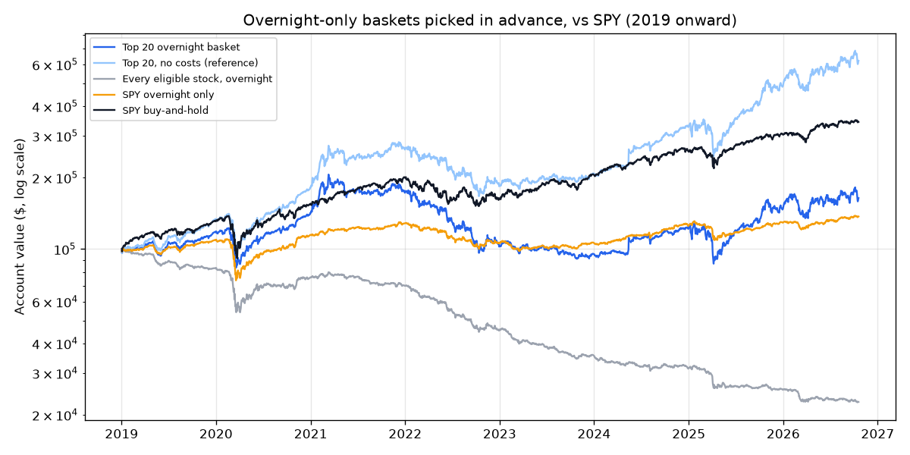

# Overnight Drift Screener — 2026-10-20

*Paper research only; not investment advice. Rules: [overnight_screener_preregistration.md](overnight_screener_preregistration.md), committed before any data was fetched.*

## Verdict: **NO-GO** (4 of 7 bars passed)

| Bar | Result | Detail |
|---|---|---|
| 1 · Data check | PASS | no problems |
| 2 · Makes money after costs | PASS | CAGR 6.55% |
| 3 · Worth the risk (Sharpe ≥ SPY buy-and-hold) | **FAIL** | 0.37 vs 0.93 |
| 4 · Picking adds value (beats no-selection basket) | PASS | 6.55% vs -17.33% |
| 5 · Consistent (positive in ≥ 5 of 8 years) | PASS | 6 of 8 |
| 6 · Survives double costs | **FAIL** | CAGR -10.20% |
| 7 · Not fragile (top 10 and top 40 pass bars 2 and 3) | **FAIL** | top 10: CAGR 6.17%, Sharpe 0.35; top 40: CAGR 6.34%, Sharpe 0.38 |

## Does picking in advance work? (walk-forward, 2019-01-02 to 2026-10-19)

Each January the screener picks its top stocks using only the three years before. The basket then buys at every close and sells at every next open for that whole year, paying the cost in the rules.

| | Total return | Annual (CAGR) | Worst drop | Sharpe | Nights up |
|---|---|---|---|---|---|
| Top 20 overnight basket | +64% | +6.55% | 57.9% | 0.37 | 55% |
| Top 20, double costs | -57% | -10.20% | 80.4% | -0.28 | 52% |
| Top 20, no costs (reference) | +522% | +26.41% | 40.9% | 1.03 | 57% |
| Top 10 | +60% | +6.17% | 63.6% | 0.35 | 55% |
| Top 40 | +62% | +6.34% | 52.0% | 0.38 | 55% |
| Every eligible stock, overnight | -77% | -17.33% | 77.4% | -1.30 | 48% |
| SPY overnight only | +37% | +4.13% | 33.0% | 0.39 | 55% |
| SPY buy-and-hold | +243% | +17.14% | 33.8% | 0.93 | 55% |

**Year by year**

| Year | Top 20 overnight basket | Top 20, no costs (reference) | Every eligible stock, overnight | SPY overnight only | SPY buy-and-hold |
|---|---|---|---|---|---|
| 2019 | +17.5% | +32.8% | -17.2% | +9.0% | +31.1% |
| 2020 | +20.3% | +36.5% | -8.5% | +5.2% | +18.5% |
| 2021 | +22.0% | +44.8% | -7.8% | +11.8% | +28.6% |
| 2022 | -40.7% | -30.0% | -35.1% | -17.5% | -18.2% |
| 2023 | -6.8% | +13.3% | -21.4% | +0.7% | +26.2% |
| 2024 | +27.6% | +57.3% | -11.9% | +17.7% | +24.9% |
| 2025 | +21.4% | +48.8% | -18.8% | +3.0% | +17.7% |
| 2026 | +10.9% | +27.5% | -11.0% | +6.2% | +13.3% |

**What the basket held each year** (top 20, in rank order):

- **2019:** AMZN, EXE, BRK.B, BABA, MU, AMD, XYZ, EXEL, NFLX, BAC, MSFT, TTWO, SHOP, JD, V, VKTX, VALE, ADBE, WYNN, CAT
- **2020:** MSFT, AMZN, BABA, V, EXE, AMD, DIS, TTD, CRSP, XBI, IWM, OKTA, NFLX, ARWR, BRK.B, NVDA, LULU, JD, SPY, SRPT
- **2021:** ARKG, PLUG, RIOT, MGNI, MARA, FCEL, NVAX, ARKK, APPS, ALTO, AMZN, AMD, BILI, SE, RNG, PENN, ENPH, MSFT, CRSP, TTD
- **2022:** UUUU, RIOT, UMC, SE, FUTU, ARKG, SENS, PLUG, AMD, MARA, F, MRNA, NVDA, LAC, FCEL, LAZR, TSM, MELI, PENN, NIO
- **2023:** BRK.A, TSLA, AR, NOG, GFI, AMC, UMC, GME, NLY, APA, ENPH, DQ, AAL, ET, JETS, FUTU, TSM, BA, CHPT, F
- **2024:** BRK.A, BRK.B, ET, ACHR, URNM, IONQ, SQM, PWR, SOFI, CALF, LLY, JOBY, GME, AMC, USO, EOG, XOP, VLO, BP, OXY
- **2025:** BRK.A, QUBT, QBTS, RGTI, SMR, ACHR, BRK.B, INOD, WULF, OKLO, RKLB, LEU, LUNR, ET, CLSK, POWL, LLY, AVGO, VST, IREN
- **2026:** QBTS, NB, POET, AMPX, RGTI, SMR, QUBT, WULF, ASPI, ASM, IREN, ET, CIFR, ONDS, TMC, MSTR, ACHR, NLR, APLD, WDC

Nights beyond ±50% inside the basket (7):

- 2020-06-08 EXE: +62%
- 2020-06-09 EXE: -71%
- 2023-03-22 GME: +51%
- 2024-05-13 GME: +51%
- 2024-05-14 GME: +113%
- 2024-05-14 AMC: +129%
- 2024-06-03 GME: +74%

## Tonight's screener (last 756 trading days, 2023-10-13 to 2026-10-19)

2,415 stocks and ETFs were liquid enough to rank; **1,754** passed the filters (positive trimmed overnight average, overnight beat daytime in at least 2 of 3 years). Top 50 by t-stat of the after-cost overnight return. 1 bp = 0.01%. The full list is in [overnight_screener_2026-10-19.csv](overnight_screener_2026-10-19.csv).

For reference, **SPY**: overnight +6.2 bp/night, daytime +2.3 bp/day; $1 held only overnight became $1.58, only daytime $1.16.

| # | Symbol | Name | Price | $ vol/day | Overnight avg (bp) | Day avg (bp) | Nights up | Trimmed (bp) | t-stat | Yrs on>day | $1 overnight | $1 daytime | Cost (bp) | After-cost / yr | Worst drop | Last 12 mo (bp) |
|---|---|---|---|---|---|---|---|---|---|---|---|---|---|---|---|---|
| 1 | **QBTS** | D-Wave Quantum Inc. Common S… | $11.83 | $254M | +67.5 | -2.3 | 56% | +62.6 | 4.24 | 3/3 | $87.75 | $0.14 | 5 | +292.0% | 51% | -8.9 |
| 2 | **BWET** | Breakwave Tanker Shipping ETF | $871.34 | $96M | +70.6 | -4.4 | 54% | +63.6 | 4.14 | 2/3 | $114.29 | $0.46 | 10 | +277.7% | 42% | +193.1 |
| 3 | **ONDS** | Ondas Inc. Common Stock | $6.06 | $474M | +71.5 | -0.3 | 54% | +57.8 | 4.09 | 2/3 | $111.37 | $0.13 | 5 | +324.4% | 44% | +48.4 |
| 4 | **WULF** | TeraWulf Inc. Common Stock | $12.06 | $470M | +63.5 | -2.6 | 56% | +59.1 | 4.03 | 3/3 | $66.91 | $0.18 | 5 | +258.1% | 46% | +33.8 |
| 5 | **USAR** | USA Rare Earth, Inc. Class A… | $10.09 | $185M | +56.4 | -32.9 | 53% | +45.3 | 3.81 | 3/3 | $47.25 | $0.02 | 10 | +181.3% | 42% | +10.2 |
| 6 | **AMPX** | Amprius Technologies, Inc. | $7.59 | $49M | +64.5 | -29.6 | 57% | +66.5 | 3.77 | 3/3 | $85.65 | $0.02 | 20 | +166.9% | 43% | +28.0 |
| 7 | **IREN** | IREN Limited Ordinary Shares | $27.73 | $1,656M | +50.9 | +4.1 | 53% | +49.5 | 3.59 | 3/3 | $27.38 | $0.33 | 2 | +186.6% | 47% | +20.1 |
| 8 | **LITE** | Lumentum Holdings Inc. Commo… | $834.51 | $3,922M | +38.4 | +13.0 | 55% | +35.4 | 3.52 | 3/3 | $13.43 | $1.49 | 2 | +126.0% | 27% | +62.2 |
| 9 | **TSM** | Taiwan Semiconductor Manufac… | $420.22 | $4,376M | +25.5 | -1.6 | 57% | +26.8 | 3.49 | 3/3 | $6.04 | $0.78 | 2 | +73.2% | 33% | +23.2 |
| 10 | **NVDA** | NVIDIA Corporation Common St… | $217.09 | $25,191M | +24.7 | +0.2 | 59% | +25.8 | 3.42 | 3/3 | $5.67 | $0.82 | 2 | +69.6% | 31% | +20.7 |
| 11 | **SMR** | NuScale Power Corporation | $5.69 | $279M | +47.7 | -19.4 | 57% | +51.7 | 3.36 | 3/3 | $22.79 | $0.05 | 5 | +150.0% | 47% | -0.3 |
| 12 | **AVGO** | Broadcom Inc. Common Stock | $334.59 | $7,828M | +28.0 | -5.3 | 57% | +26.3 | 3.34 | 3/3 | $6.99 | $0.55 | 2 | +81.8% | 23% | +19.6 |
| 13 | **APLD** | Applied Digital Corporation … | $19.25 | $458M | +51.8 | -7.8 | 55% | +40.2 | 3.25 | 3/3 | $28.91 | $0.13 | 5 | +170.7% | 46% | +28.7 |
| 14 | **POET** | POET Technologies Inc. Commo… | $5.52 | $66M | +56.7 | -18.1 | 55% | +59.6 | 3.23 | 3/3 | $38.47 | $0.05 | 10 | +162.6% | 45% | +19.4 |
| 15 | **SMH** | VanEck Semiconductor ETF | $548.46 | $3,710M | +20.5 | -0.5 | 57% | +21.4 | 3.21 | 3/3 | $4.27 | $0.86 | 2 | +54.3% | 26% | +21.9 |
| 16 | **RTX** | RTX Corporation | $192.11 | $804M | +15.3 | -0.7 | 58% | +13.7 | 3.21 | 3/3 | $3.09 | $0.90 | 5 | +28.5% | 19% | +22.0 |
| 17 | **CEG** | Constellation Energy Corpora… | $263.19 | $770M | +26.6 | -9.9 | 60% | +25.1 | 3.14 | 3/3 | $6.52 | $0.36 | 5 | +64.7% | 35% | +17.7 |
| 18 | **MU** | Micron Technology, Inc. Comm… | $904.90 | $26,315M | +33.7 | +8.4 | 56% | +29.9 | 3.12 | 3/3 | $9.56 | $1.37 | 2 | +101.8% | 29% | +49.7 |
| 19 | **HUT** | Hut 8 Corp. Common Stock | $68.17 | $416M | +46.9 | +3.6 | 53% | +44.0 | 3.12 | 3/3 | $20.76 | $0.36 | 5 | +142.4% | 38% | +30.0 |
| 20 | **FTAI** | FTAI Aviation Ltd. Common St… | $163.34 | $268M | +29.9 | -0.7 | 58% | +28.5 | 3.11 | 3/3 | $7.94 | $0.61 | 5 | +75.9% | 35% | +31.5 |
| 21 | **HWM** | Howmet Aerospace Inc. | $220.03 | $618M | +19.3 | +3.8 | 60% | +16.9 | 3.08 | 2/3 | $4.05 | $1.20 | 5 | +40.6% | 25% | +19.3 |
| 22 | **NVDL** | GraniteShares ETF Trust Gran… ⚠️ leveraged | $32.87 | $370M | +45.2 | -1.8 | 58% | +47.6 | 3.06 | 3/3 | $18.33 | $0.38 | 5 | +132.5% | 56% | +37.0 |
| 23 | **SLS** | SELLAS Life Sciences Group, … | $10.49 | $64M | +45.4 | +4.8 | 50% | +48.9 | 3.03 | 2/3 | $20.43 | $0.48 | 10 | +112.6% | 39% | +29.7 |
| 24 | **UUUU** | Energy Fuels Inc. | $8.16 | $86M | +36.9 | -23.8 | 54% | +34.5 | 3.00 | 3/3 | $12.94 | $0.09 | 10 | +82.6% | 37% | +19.4 |
| 25 | **MP** | MP Materials Corp. | $38.95 | $277M | +37.6 | -15.3 | 54% | +27.8 | 2.93 | 3/3 | $12.64 | $0.18 | 5 | +105.4% | 19% | +17.9 |
| 26 | **IBRX** | ImmunityBio, Inc. Common Sto… | $8.42 | $77M | +41.1 | +4.9 | 50% | +34.9 | 2.92 | 3/3 | $16.14 | $0.41 | 10 | +96.5% | 33% | +40.3 |
| 27 | **FIX** | Comfort Systems USA, Inc. | $1,464.07 | $565M | +26.1 | +8.6 | 59% | +23.5 | 2.88 | 3/3 | $6.17 | $1.45 | 5 | +61.7% | 27% | +25.7 |
| 28 | **VRT** | Vertiv Holdings Co Class A C… | $206.08 | $1,143M | +30.8 | -0.3 | 58% | +30.8 | 2.87 | 3/3 | $7.68 | $0.64 | 2 | +87.6% | 53% | +29.0 |
| 29 | **NVDX** | T-Rex 2X Long NVIDIA Daily T… ⚠️ leveraged | $18.49 | $91M | +48.0 | -0.9 | 59% | +50.4 | 2.86 | 3/3 | $21.95 | $0.40 | 10 | +118.2% | 59% | +35.9 |
| 30 | **QUBT** | Quantum Computing Inc. Commo… | $6.42 | $61M | +55.5 | +5.3 | 53% | +52.5 | 2.83 | 2/3 | $31.46 | $0.21 | 10 | +145.5% | 61% | +18.4 |
| 31 | **MSTR** | Strategy Inc Common Stock Cl… | $136.02 | $2,703M | +35.4 | +0.3 | 54% | +35.8 | 2.82 | 3/3 | $9.66 | $0.44 | 2 | +102.5% | 36% | +2.3 |
| 32 | **STX** | Seagate Technology Holdings … | $660.81 | $3,447M | +25.2 | +11.9 | 55% | +23.3 | 2.81 | 3/3 | $5.53 | $1.83 | 2 | +68.2% | 34% | +33.6 |
| 33 | **CRDO** | Credo Technology Group Holdi… | $172.81 | $1,349M | +35.9 | +11.0 | 55% | +32.0 | 2.81 | 3/3 | $10.06 | $1.11 | 2 | +105.3% | 55% | +37.2 |
| 34 | **OKLO** | Oklo Inc. | $27.24 | $333M | +37.6 | +0.4 | 55% | +39.0 | 2.78 | 2/3 | $11.53 | $0.23 | 5 | +99.2% | 42% | +17.8 |
| 35 | **LHX** | L3Harris Technologies, Inc. | $243.84 | $368M | +12.8 | -6.4 | 59% | +11.0 | 2.77 | 3/3 | $2.58 | $0.58 | 5 | +20.9% | 11% | +12.5 |
| 36 | **TTMI** | TTM Technologies, Inc. Commo… | $99.10 | $277M | +31.5 | +4.5 | 54% | +23.2 | 2.73 | 3/3 | $8.35 | $0.94 | 5 | +78.9% | 27% | +45.6 |
| 37 | **AIRR** | First Trust Exchange-Traded … | $98.78 | $80M | +19.7 | -9.4 | 62% | +20.1 | 2.73 | 3/3 | $4.28 | $0.46 | 10 | +26.3% | 23% | +21.9 |
| 38 | **NBIS** | Nebius Group N.V. Class A Or… | $170.24 | $3,641M | +40.6 | +6.6 | 39% | +31.8 | 2.73 | 2/3 | $11.22 | $0.76 | 2 | +113.5% | 46% | +41.0 |
| 39 | **AAOI** | Applied Optoelectronics, Inc… | $78.20 | $1,015M | +42.3 | +19.3 | 56% | +35.1 | 2.72 | 3/3 | $13.34 | $0.74 | 2 | +125.5% | 35% | +31.7 |
| 40 | **PWR** | Quanta Services, Inc. | $618.41 | $605M | +20.3 | -0.6 | 57% | +17.8 | 2.66 | 3/3 | $4.22 | $0.83 | 5 | +42.5% | 25% | +26.1 |
| 41 | **CCJ** | Cameco Corporation | $80.70 | $251M | +20.9 | -5.6 | 56% | +19.7 | 2.66 | 3/3 | $4.38 | $0.51 | 5 | +44.3% | 21% | +14.8 |
| 42 | **MRVL** | Marvell Technology, Inc. Com… | $237.09 | $4,716M | +30.0 | -1.6 | 53% | +30.3 | 2.65 | 3/3 | $7.02 | $0.62 | 2 | +82.1% | 44% | +48.8 |
| 43 | **RKLB** | Rocket Lab Corporation Commo… | $51.36 | $1,234M | +29.7 | +17.8 | 56% | +28.1 | 2.63 | 2/3 | $6.92 | $1.68 | 2 | +81.2% | 43% | +14.6 |
| 44 | **WELL** | Welltower Inc. | $233.51 | $585M | +10.9 | +4.2 | 55% | +10.2 | 2.62 | 3/3 | $2.25 | $1.30 | 5 | +15.5% | 9% | +12.1 |
| 45 | **LRCX** | Lam Research Corporation Com… | $272.20 | $2,614M | +24.3 | +0.7 | 55% | +21.6 | 2.61 | 3/3 | $5.13 | $0.83 | 2 | +64.0% | 24% | +37.1 |
| 46 | **XLI** | State Street Industrial Sele… | $166.68 | $1,228M | +7.8 | -0.3 | 59% | +7.7 | 2.61 | 3/3 | $1.78 | $0.95 | 2 | +15.3% | 16% | +9.9 |
| 47 | **JEPQ** | J.P. Morgan Exchange-Traded … | $59.50 | $318M | +11.1 | -3.3 | 65% | +12.1 | 2.61 | 3/3 | $2.27 | $0.76 | 5 | +15.9% | 15% | +8.9 |
| 48 | **WDC** | Western Digital Corporation … | $352.21 | $3,172M | +26.2 | +13.6 | 53% | +25.1 | 2.59 | 2/3 | $5.64 | $2.02 | 2 | +69.3% | 39% | +24.9 |
| 49 | **BE** | Bloom Energy Corporation | $226.22 | $3,258M | +40.8 | +17.8 | 53% | +32.5 | 2.58 | 2/3 | $11.98 | $1.66 | 2 | +117.6% | 40% | +60.9 |
| 50 | **RGTI** | Rigetti Computing, Inc. Comm… | $11.67 | $244M | +45.8 | +14.7 | 53% | +39.7 | 2.57 | 2/3 | $15.94 | $0.49 | 5 | +121.9% | 68% | -19.4 |

**How to read it.** *Overnight avg* is the average close-to-open move. *Trimmed* drops the biggest 1% of nights each way (mostly earnings gaps), so a high trimmed number means a steady drift, not a few big jumps. *t-stat* above 2 means the after-cost average is unlikely to be luck. *Cost* is the assumed round trip; if *Overnight avg* is not comfortably above it, the trade doesn't pay. *Last 12 mo* shows whether the pattern is fading.

## Limits (from the rules, section G)

- **Survivorship bias:** only stocks listed today are included, which flatters every historical number.
- Earnings nights are not removed; the trimmed average is the stand-in.
- Prices are the daily bar's open and close, taken as the auction prices.
- Taxes are ignored; every trade would be short-term.
