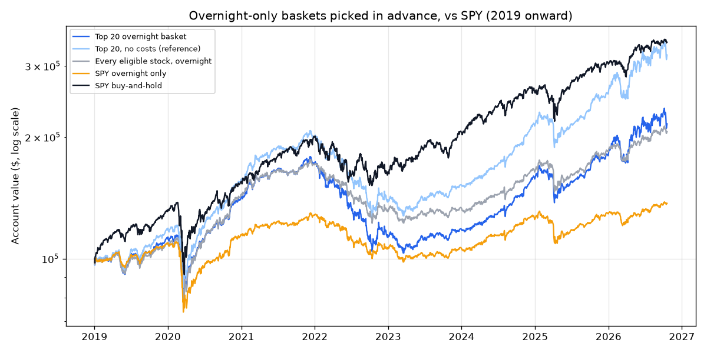

# Overnight Drift, Big Liquid Stocks Only ($1B+/day) — 2026-10-20

*Paper research only; not investment advice. Rules: [overnight_liquid_preregistration.md](overnight_liquid_preregistration.md), committed before this ran. This is a follow-up on a pattern already seen in the first test ([overnight_screener_2026-10-20.md](overnight_screener_2026-10-20.md)), so a pass is weaker evidence than a pass on a fresh idea.*

## Verdict: **NO-GO** (5 of 7 bars passed)

| Bar | Result | Detail |
|---|---|---|
| 1 · Data check | PASS | no problems |
| 2 · Makes money after costs | PASS | CAGR 10.36% |
| 3 · Worth the risk (Sharpe ≥ SPY buy-and-hold) | **FAIL** | 0.63 vs 0.93 |
| 4 · Picking adds value (beats no-selection basket) | PASS | 10.36% vs 9.73% |
| 5 · Consistent (positive in ≥ 5 of 8 years) | PASS | 7 of 8 |
| 6 · Survives double costs | PASS | CAGR 4.95% |
| 7 · Not fragile (top 10 and top 40 pass bars 2 and 3) | **FAIL** | top 10: CAGR 11.58%, Sharpe 0.65; top 40: CAGR 11.39%, Sharpe 0.74 |

## Does picking in advance work? (walk-forward, 2019-01-02 to 2026-10-19)

Each January the screener picks its top stocks using only the three years before. The basket then buys at every close and sells at every next open for that whole year, paying the cost in the rules.

| | Total return | Annual (CAGR) | Worst drop | Sharpe | Nights up |
|---|---|---|---|---|---|
| Top 20 overnight basket | +116% | +10.36% | 42.3% | 0.63 | 56% |
| Top 20, double costs | +46% | +4.95% | 45.8% | 0.36 | 54% |
| Top 20, no costs (reference) | +219% | +16.05% | 39.2% | 0.90 | 57% |
| Top 10 | +135% | +11.58% | 47.7% | 0.65 | 55% |
| Top 40 | +132% | +11.39% | 33.6% | 0.74 | 56% |
| Every eligible stock, overnight | +106% | +9.73% | 30.5% | 0.69 | 56% |
| SPY overnight only | +37% | +4.13% | 33.0% | 0.39 | 55% |
| SPY buy-and-hold | +243% | +17.14% | 33.8% | 0.93 | 55% |

**Year by year**

| Year | Top 20 overnight basket | Top 20, no costs (reference) | Every eligible stock, overnight | SPY overnight only | SPY buy-and-hold |
|---|---|---|---|---|---|
| 2019 | +12.1% | +17.9% | +8.9% | +9.0% | +31.1% |
| 2020 | +26.6% | +33.2% | +32.4% | +5.2% | +18.5% |
| 2021 | +20.8% | +27.0% | +18.5% | +11.8% | +28.6% |
| 2022 | -34.2% | -30.8% | -23.4% | -17.5% | -18.2% |
| 2023 | +5.0% | +10.4% | +2.4% | +0.7% | +26.2% |
| 2024 | +33.2% | +40.1% | +22.7% | +17.7% | +24.9% |
| 2025 | +14.0% | +19.8% | +12.1% | +3.0% | +17.7% |
| 2026 | +19.8% | +24.7% | +12.0% | +6.2% | +13.3% |

Years with fewer qualifying names than the basket size (allowed in this version): 2019: only 32 stocks qualified for top 40; 2020: only 20 stocks qualified for top 40; 2021: only 31 stocks qualified for top 40; 2023: only 26 stocks qualified for top 40; 2024: only 18 stocks qualified for top 20; 2024: only 18 stocks qualified for top 40; 2025: only 22 stocks qualified for top 40.

**Information only: the same test with a $500M floor** (cannot change the verdict)

| | Total return | Annual (CAGR) | Worst drop | Sharpe | Nights up |
|---|---|---|---|---|---|
| Top 20 overnight basket | +74% | +7.35% | 48.8% | 0.45 | 56% |
| Top 20, double costs | -5% | -0.64% | 55.4% | 0.07 | 54% |
| Top 20, no costs (reference) | +218% | +15.98% | 45.2% | 0.82 | 57% |
| Every eligible stock, overnight | +13% | +1.53% | 33.5% | 0.18 | 54% |

**What the basket held each year** (top 20, in rank order):

- **2019:** AMZN, BRK.B, BABA, MU, AMD, XYZ, NFLX, BAC, MSFT, V, ADBE, JPM, DIA, MA, GOOGL, BA, CSCO, QQQ, IWM, TSLA
- **2020:** MSFT, AMZN, BABA, V, AMD, DIS, IWM, NFLX, NVDA, SPY, QQQ, JPM, BAC, XLF, AAPL, BA, GOOGL, EEM, GDX, META
- **2021:** AMZN, AMD, MSFT, NIO, DIS, AAL, ADBE, MA, NVDA, CRM, BA, GLD, PFE, V, IWM, BABA, PYPL, BRK.B, QQQ, TLT
- **2022:** SE, AMD, F, MRNA, NVDA, NIO, TSLA, PFE, AMAT, SHOP, XYZ, IWM, AMZN, QCOM, MU, MA, PYPL, BA, DIS, AVGO
- **2023:** BRK.A, TSLA, BA, AVGO, BRK.B, AMD, XLE, XOM, IWM, NVDA, AMZN, CVX, JPM, XLF, BAC, DIS, V, ADBE, VOO, IVV
- **2024:** BRK.A, BRK.B, LLY, XLE, AVGO, CVX, TSLA, IWM, BAC, UNH, AMD, XLU, JPM, XLF, AMZN, UBER, NFLX, GLD
- **2025:** BRK.A, BRK.B, LLY, AVGO, MSTR, TSM, APP, TSLA, WMT, GLD, AMD, IWM, WFC, AMZN, NOW, MSFT, UBER, NFLX, XLF, UNH
- **2026:** QBTS, RGTI, IREN, MSTR, WDC, NVDA, APP, OKLO, AVGO, VRT, GLD, TSM, RKLB, SMH, CVNA, SLV, MU, BRK.B, LITE, APH

## Tonight's screener (last 756 trading days, 2023-10-13 to 2026-10-19)

119 stocks and ETFs were liquid enough to rank; **82** passed the filters (positive trimmed overnight average, overnight beat daytime in at least 2 of 3 years). Top 50 by t-stat of the after-cost overnight return. 1 bp = 0.01%. The full list is in [overnight_screener_liquid_2026-10-19.csv](overnight_screener_liquid_2026-10-19.csv).

For reference, **SPY**: overnight +6.2 bp/night, daytime +2.3 bp/day; $1 held only overnight became $1.58, only daytime $1.16.

| # | Symbol | Name | Price | $ vol/day | Overnight avg (bp) | Day avg (bp) | Nights up | Trimmed (bp) | t-stat | Yrs on>day | $1 overnight | $1 daytime | Cost (bp) | After-cost / yr | Worst drop | Last 12 mo (bp) |
|---|---|---|---|---|---|---|---|---|---|---|---|---|---|---|---|---|
| 1 | **IREN** | IREN Limited Ordinary Shares | $27.73 | $1,656M | +50.9 | +4.1 | 53% | +49.5 | 3.59 | 3/3 | $27.38 | $0.33 | 2 | +186.6% | 47% | +20.1 |
| 2 | **LITE** | Lumentum Holdings Inc. Commo… | $834.51 | $3,922M | +38.4 | +13.0 | 55% | +35.4 | 3.52 | 3/3 | $13.43 | $1.49 | 2 | +126.0% | 27% | +62.2 |
| 3 | **TSM** | Taiwan Semiconductor Manufac… | $420.22 | $4,376M | +25.5 | -1.6 | 57% | +26.8 | 3.49 | 3/3 | $6.04 | $0.78 | 2 | +73.2% | 33% | +23.2 |
| 4 | **NVDA** | NVIDIA Corporation Common St… | $217.09 | $25,191M | +24.7 | +0.2 | 59% | +25.8 | 3.42 | 3/3 | $5.67 | $0.82 | 2 | +69.6% | 31% | +20.7 |
| 5 | **AVGO** | Broadcom Inc. Common Stock | $334.59 | $7,828M | +28.0 | -5.3 | 57% | +26.3 | 3.34 | 3/3 | $6.99 | $0.55 | 2 | +81.8% | 23% | +19.6 |
| 6 | **SMH** | VanEck Semiconductor ETF | $548.46 | $3,710M | +20.5 | -0.5 | 57% | +21.4 | 3.21 | 3/3 | $4.27 | $0.86 | 2 | +54.3% | 26% | +21.9 |
| 7 | **MU** | Micron Technology, Inc. Comm… | $904.90 | $26,315M | +33.7 | +8.4 | 56% | +29.9 | 3.12 | 3/3 | $9.56 | $1.37 | 2 | +101.8% | 29% | +49.7 |
| 8 | **VRT** | Vertiv Holdings Co Class A C… | $206.08 | $1,143M | +30.8 | -0.3 | 58% | +30.8 | 2.87 | 3/3 | $7.68 | $0.64 | 2 | +87.6% | 53% | +29.0 |
| 9 | **MSTR** | Strategy Inc Common Stock Cl… | $136.02 | $2,703M | +35.4 | +0.3 | 54% | +35.8 | 2.82 | 3/3 | $9.66 | $0.44 | 2 | +102.5% | 36% | +2.3 |
| 10 | **STX** | Seagate Technology Holdings … | $660.81 | $3,447M | +25.2 | +11.9 | 55% | +23.3 | 2.81 | 3/3 | $5.53 | $1.83 | 2 | +68.2% | 34% | +33.6 |
| 11 | **CRDO** | Credo Technology Group Holdi… | $172.81 | $1,349M | +35.9 | +11.0 | 55% | +32.0 | 2.81 | 3/3 | $10.06 | $1.11 | 2 | +105.3% | 55% | +37.2 |
| 12 | **NBIS** | Nebius Group N.V. Class A Or… | $170.24 | $3,641M | +40.6 | +6.6 | 39% | +31.8 | 2.73 | 2/3 | $11.22 | $0.76 | 2 | +113.5% | 46% | +41.0 |
| 13 | **AAOI** | Applied Optoelectronics, Inc… | $78.20 | $1,015M | +42.3 | +19.3 | 56% | +35.1 | 2.72 | 3/3 | $13.34 | $0.74 | 2 | +125.5% | 35% | +31.7 |
| 14 | **MRVL** | Marvell Technology, Inc. Com… | $237.09 | $4,716M | +30.0 | -1.6 | 53% | +30.3 | 2.65 | 3/3 | $7.02 | $0.62 | 2 | +82.1% | 44% | +48.8 |
| 15 | **RKLB** | Rocket Lab Corporation Commo… | $51.36 | $1,234M | +29.7 | +17.8 | 56% | +28.1 | 2.63 | 2/3 | $6.92 | $1.68 | 2 | +81.2% | 43% | +14.6 |
| 16 | **LRCX** | Lam Research Corporation Com… | $272.20 | $2,614M | +24.3 | +0.7 | 55% | +21.6 | 2.61 | 3/3 | $5.13 | $0.83 | 2 | +64.0% | 24% | +37.1 |
| 17 | **XLI** | State Street Industrial Sele… | $166.68 | $1,228M | +7.8 | -0.3 | 59% | +7.7 | 2.61 | 3/3 | $1.78 | $0.95 | 2 | +15.3% | 16% | +9.9 |
| 18 | **WDC** | Western Digital Corporation … | $352.21 | $3,172M | +26.2 | +13.6 | 53% | +25.1 | 2.59 | 2/3 | $5.64 | $2.02 | 2 | +69.3% | 39% | +24.9 |
| 19 | **BE** | Bloom Energy Corporation | $226.22 | $3,258M | +40.8 | +17.8 | 53% | +32.5 | 2.58 | 2/3 | $11.98 | $1.66 | 2 | +117.6% | 40% | +60.9 |
| 20 | **VTI** | Vanguard Morningstar Total S… | $375.54 | $1,082M | +7.7 | +0.8 | 62% | +8.2 | 2.50 | 3/3 | $1.76 | $1.03 | 2 | +14.8% | 17% | +7.9 |
| 21 | **COHR** | Coherent Corp. | $232.02 | $1,878M | +28.6 | +7.7 | 56% | +27.9 | 2.48 | 3/3 | $6.23 | $1.10 | 2 | +75.0% | 33% | +34.2 |
| 22 | **SOXX** | iShares Semiconductor ETF | $501.93 | $3,999M | +16.8 | +1.4 | 56% | +17.2 | 2.44 | 3/3 | $3.21 | $0.97 | 2 | +40.3% | 26% | +21.8 |
| 23 | **SOXL** | Direxion Daily Semiconductor… ⚠️ leveraged | $98.65 | $7,916M | +45.5 | +3.2 | 56% | +46.7 | 2.41 | 3/3 | $12.24 | $0.40 | 2 | +119.2% | 62% | +59.0 |
| 24 | **ASML** | ASML Holding N.V. New York R… | $1,647.12 | $2,295M | +19.3 | -2.3 | 54% | +19.9 | 2.40 | 3/3 | $3.71 | $0.74 | 2 | +47.2% | 21% | +19.9 |
| 25 | **GLD** | SPDR Gold Trust, SPDR Gold S… | $379.69 | $3,480M | +11.1 | +0.2 | 58% | +11.8 | 2.37 | 3/3 | $2.21 | $0.99 | 2 | +23.9% | 17% | +7.3 |
| 26 | **CVX** | Chevron Corporation | $224.37 | $1,591M | +9.2 | -2.1 | 57% | +10.0 | 2.31 | 3/3 | $1.95 | $0.81 | 2 | +18.8% | 16% | +13.3 |
| 27 | **LLY** | Eli Lilly & Co. | $1,240.34 | $2,745M | +14.1 | -1.9 | 57% | +12.8 | 2.29 | 2/3 | $2.68 | $0.77 | 2 | +32.1% | 25% | +17.3 |
| 28 | **RSP** | Invesco S&P 500 Equal Weight… | $213.40 | $1,392M | +6.1 | +0.5 | 58% | +6.1 | 2.26 | 3/3 | $1.57 | $1.01 | 2 | +10.5% | 11% | +6.4 |
| 29 | **TJX** | TJX Companies, Inc. (The) | $147.36 | $1,028M | +7.6 | +0.3 | 55% | +6.4 | 2.26 | 3/3 | $1.75 | $0.99 | 2 | +14.5% | 10% | +5.5 |
| 30 | **HOOD** | Robinhood Markets, Inc. Clas… | $96.52 | $1,993M | +23.7 | +17.5 | 53% | +24.3 | 2.22 | 3/3 | $4.56 | $2.28 | 2 | +57.7% | 43% | +7.1 |
| 31 | **BRK.B** | BERKSHIRE HATHAWAY Class B | $532.23 | $2,183M | +6.0 | +0.3 | 58% | +6.9 | 2.17 | 2/3 | $1.56 | $0.99 | 2 | +10.2% | 17% | +1.5 |
| 32 | **GLW** | Corning Incorporated | $132.74 | $1,265M | +17.8 | +8.3 | 56% | +18.2 | 2.15 | 3/3 | $3.29 | $1.53 | 2 | +41.4% | 24% | +26.1 |
| 33 | **XLK** | State Street Technology Sele… | $185.96 | $1,299M | +10.0 | +1.8 | 58% | +10.8 | 2.13 | 3/3 | $2.05 | $1.08 | 2 | +20.8% | 23% | +11.4 |
| 34 | **TQQQ** | ProShares UltraPro QQQ ⚠️ leveraged | $70.64 | $3,676M | +21.0 | +4.3 | 57% | +23.1 | 2.12 | 3/3 | $3.88 | $0.97 | 2 | +49.4% | 48% | +17.8 |
| 35 | **QQQ** | Invesco QQQ Trust, Series 1 | $718.36 | $23,714M | +8.3 | +1.6 | 59% | +9.0 | 2.10 | 3/3 | $1.82 | $1.08 | 2 | +16.2% | 19% | +6.8 |
| 36 | **AMD** | Advanced Micro Devices, Inc.… | $538.05 | $11,018M | +22.1 | +6.1 | 56% | +17.9 | 2.10 | 2/3 | $4.14 | $1.19 | 2 | +52.7% | 37% | +20.3 |
| 37 | **IVV** | iShares Core S&P 500 ETF | $770.01 | $4,006M | +6.6 | +2.0 | 60% | +6.9 | 2.09 | 3/3 | $1.62 | $1.13 | 2 | +11.7% | 17% | +6.2 |
| 38 | **ANET** | Arista Networks | $182.95 | $1,029M | +18.2 | +4.6 | 58% | +17.9 | 2.08 | 2/3 | $3.32 | $1.14 | 2 | +41.9% | 40% | +24.4 |
| 39 | **VOO** | Vanguard S&P 500 ETF | $704.60 | $4,751M | +6.5 | +2.0 | 60% | +6.9 | 2.07 | 3/3 | $1.62 | $1.14 | 2 | +11.6% | 17% | +6.2 |
| 40 | **CAT** | Caterpillar Inc. | $725.79 | $1,985M | +12.3 | +3.6 | 57% | +11.7 | 2.06 | 2/3 | $2.36 | $1.19 | 2 | +26.6% | 21% | +21.9 |
| 41 | **COIN** | Coinbase Global, Inc. Class … | $168.45 | $1,357M | +22.5 | +0.1 | 52% | +22.0 | 2.04 | 3/3 | $4.10 | $0.55 | 2 | +52.2% | 41% | -7.3 |
| 42 | **ORCL** | Oracle Corp | $129.59 | $3,829M | +19.2 | -11.3 | 55% | +16.1 | 2.03 | 3/3 | $3.50 | $0.35 | 2 | +44.4% | 27% | +1.1 |
| 43 | **SPY** | State Street SPDR S&P 500 ET… | $766.48 | $31,838M | +6.2 | +2.3 | 60% | +6.6 | 1.91 | 3/3 | $1.58 | $1.16 | 2 | +10.7% | 17% | +5.9 |
| 44 | **UBER** | Uber Technologies, Inc. | $69.96 | $1,139M | +11.2 | -2.7 | 53% | +11.3 | 1.91 | 3/3 | $2.18 | $0.70 | 2 | +23.3% | 25% | +6.6 |
| 45 | **VLO** | Valero Energy Corporation | $433.31 | $1,012M | +9.8 | +10.2 | 56% | +10.1 | 1.89 | 2/3 | $2.00 | $1.87 | 2 | +19.7% | 21% | +15.5 |
| 46 | **APP** | Applovin Corporation Class A… | $269.12 | $1,535M | +23.0 | +14.0 | 56% | +17.5 | 1.86 | 2/3 | $4.02 | $1.69 | 2 | +51.2% | 51% | -13.1 |
| 47 | **IBIT** | iShares Bitcoin Trust ETF Sh… | $46.30 | $1,775M | +18.2 | -5.5 | 52% | +19.8 | 1.83 | 3/3 | $2.93 | $0.59 | 2 | +36.6% | 32% | -1.8 |
| 48 | **META** | Meta Platforms, Inc. Class A… | $705.44 | $11,154M | +13.3 | +0.3 | 55% | +12.4 | 1.77 | 3/3 | $2.43 | $0.91 | 2 | +27.8% | 21% | +5.1 |
| 49 | **ADI** | Analog Devices, Inc. Common … | $394.35 | $1,212M | +10.7 | +3.3 | 54% | +9.7 | 1.74 | 3/3 | $2.09 | $1.14 | 2 | +21.6% | 21% | +12.3 |
| 50 | **PLTR** | Palantir Technologies Inc. C… | $194.15 | $4,827M | +18.2 | +21.4 | 53% | +11.8 | 1.73 | 2/3 | $3.11 | $3.48 | 2 | +38.8% | 37% | +9.9 |

**How to read it.** *Overnight avg* is the average close-to-open move. *Trimmed* drops the biggest 1% of nights each way (mostly earnings gaps), so a high trimmed number means a steady drift, not a few big jumps. *t-stat* above 2 means the after-cost average is unlikely to be luck. *Cost* is the assumed round trip; if *Overnight avg* is not comfortably above it, the trade doesn't pay. *Last 12 mo* shows whether the pattern is fading.

## Limits (from the rules, section G)

- **Survivorship bias:** only stocks listed today are included, which flatters every historical number.
- Earnings nights are not removed; the trimmed average is the stand-in.
- Prices are the daily bar's open and close, taken as the auction prices.
- Taxes are ignored; every trade would be short-term.
