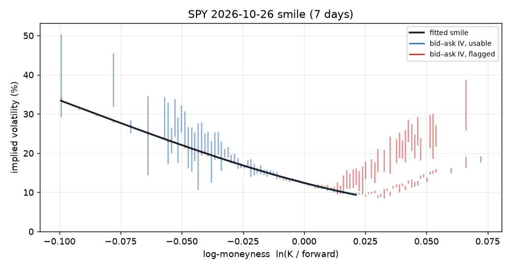
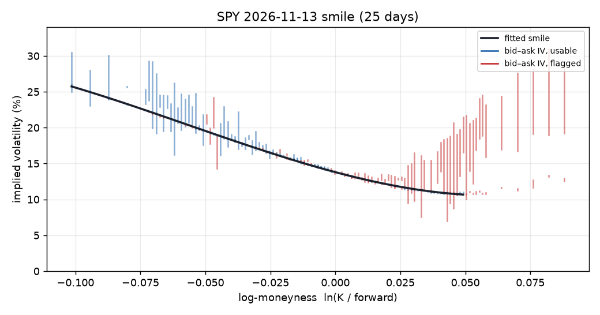
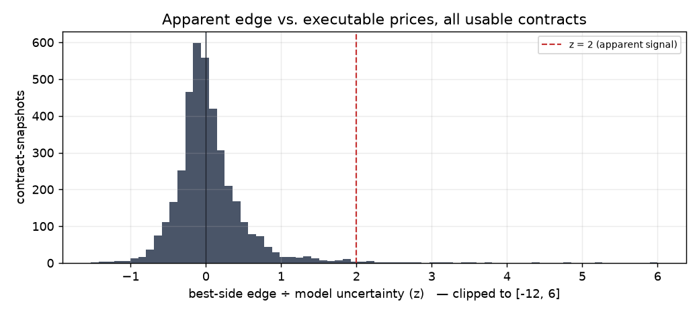

# SPY pricing residuals — 2026-10-19

Research output from `main.py report`. 7 snapshots, every 5 min from 15:27 to 15:58 ET. Options feed: **indicative**. Each snapshot uses only data received by its own timestamp.

> **Bottom line.** On paper, 46% of usable quotes look mispriced against executable prices. After allowing for model uncertainty, 0.8% remain. Those remaining signals, traded at executable prices and hedged, averaged -$16.13 per contract after 15 minutes (24% profitable) before commissions. One day of indicative data cannot show an edge; it shows the method works and where the traps are.

## 1. Inputs the model derived

Risk-free rate: DGS1MO@2026-10-15 (FRED, previous day's published yield). Forward and dividend yield implied from put-call parity near the money.

| Expiry | Days | Forward | Implied div. yield | Forward noise | ATM IV | Fit error | Points (dropped) |
|---|---:|---:|---:|---:|---:|---:|---:|
| 2026-10-26 | 7.0 | 767.60 | -1.41% | ±0.09 | 12.42% | 0.13 vol pts | 44 (0) |
| 2026-10-27 | 8.0 | 767.61 | -0.80% | ±0.06 | 12.44% | 0.12 vol pts | 45 (0) |
| 2026-10-28 | 9.0 | 767.74 | -0.94% | ±0.12 | 13.51% | 0.06 vol pts | 57 (11) |
| 2026-10-29 | 10.0 | 767.69 | -0.22% | ±0.15 | 14.00% | 0.05 vol pts | 42 (12) |
| 2026-10-30 | 11.0 | 767.96 | -0.98% | ±0.08 | 14.12% | 0.06 vol pts | 46 (10) |
| 2026-11-02 | 14.0 | 768.13 | -0.45% | ±0.49 | 13.20% | 0.11 vol pts | 20 (0) |
| 2026-11-06 | 18.0 | 768.53 | -0.50% | ±0.30 | 13.86% | 0.12 vol pts | 83 (0) |
| 2026-11-13 | 25.0 | 769.23 | -0.55% | ±0.15 | 13.80% | 0.09 vol pts | 53 (0) |

Spot at last snapshot: 766.79. A slightly negative implied dividend yield is expected here: no SPY ex-dividend date falls inside these expiries, and the market's implied financing rate typically sits a little above Treasury bills.

Median half bid-ask spread of usable contracts, in vol terms: **0.11 vol points**. Across all usable contract-snapshots, the fitted fair value fell inside the quote's own bid–ask range (in vol terms) **47%** of the time.

### Stability through the day

Change between consecutive snapshots. Real volatility moves with the market, so some change is expected; jumps far larger than the bid–ask width would mean the fit, not the market, is moving.

| Expiry | Snapshots | ATM IV range | Median Δ ATM IV | Max Δ ATM IV | Median Δ skew slope | Fit error range |
|---|---:|---:|---:|---:|---:|---:|
| 2026-10-26 | 6 | 11.82–12.51% | 0.10 pts | 0.42 pts | 0.056 | 0.04–0.14 pts |
| 2026-10-27 | 6 | 12.01–12.64% | 0.14 pts | 0.39 pts | 0.026 | 0.05–0.14 pts |
| 2026-10-28 | 6 | 13.06–13.69% | 0.12 pts | 0.42 pts | 0.016 | 0.05–0.11 pts |
| 2026-10-29 | 6 | 13.39–14.11% | 0.13 pts | 0.41 pts | 0.046 | 0.05–0.13 pts |
| 2026-10-30 | 6 | 13.77–14.12% | 0.07 pts | 0.19 pts | 0.044 | 0.02–0.07 pts |
| 2026-11-02 | 6 | 12.70–13.20% | 0.10 pts | 0.26 pts | 0.070 | 0.11–0.19 pts |
| 2026-11-06 | 6 | 13.55–14.00% | 0.14 pts | 0.32 pts | 0.023 | 0.10–0.22 pts |
| 2026-11-13 | 6 | 13.44–14.02% | 0.11 pts | 0.40 pts | 0.009 | 0.06–0.15 pts |

Cross-expiry check: at-the-money total variance fell with maturity (a term-structure inconsistency) in **0** expiry pair(s) across 7 snapshots.

## 2. How much of the data can be trusted

9,405 contract-snapshots priced; **3,893 (41%)** carried no warning flag.

| Flag | Count | Meaning |
|---|---:|---|
| `early_exercise` | 2,329 | in the money enough that American early exercise matters; Black-Scholes unreliable |
| `butterfly` | 2,076 | three strikes whose quotes allow a riskless profit, so at least one is wrong |
| `extrapolated` | 1,614 | outside the strike range the smile was fitted on |
| `low_price` | 872 | quoted under the minimum price; tick size dominates its implied vol |
| `parity` | 642 | call and put at the same strike inconsistent with the forward |
| `vertical` | 211 | a vertical spread quoted for more than its maximum payoff |
| `monotonic` | 210 | a higher-strike call (lower-strike put) quoted above its neighbour |
| `smile_outlier` | 173 | too far from the smile to be used in fitting it |
| `no_iv` | 65 | no volatility reproduces the price (e.g. below intrinsic value) |

The no-arbitrage flags (`butterfly`, `monotonic`, `vertical`, `parity`) are evidence about the data feed itself: real executable exchange quotes almost never allow riskless profits. The indicative feed does, regularly.

## 3. Apparent discrepancies vs. what survives

* Usable contract-snapshots where the model's fair value sits **outside** the bid–ask (buying at the ask or selling at the bid looks profitable on paper): **1,779 of 3,893 (46%)**.
* Of those, edges larger than 2× the model's own uncertainty: **31 (0.8%)**.

## 4. Did the apparent edges pay?

For every usable contract with z ≥ 2: enter at the executable price (ask to buy, bid to sell), hedge the SPY move with the option's delta, then look 5 and 15 minutes later. **Marked** values the position at the later mid; **exit** closes it at the later executable price. Per-contract dollars (×100). Commissions not included.

| Group | Horizon | Trades | Mean (mark) | Mean (exit) | Median (exit) | Share profitable (exit) |
|---|---:|---:|---:|---:|---:|---:|
| z ≥ 2 signals | 5 min | 25 | +$16.85 | -$1.39 | -$0.81 | 44% |
| z ≥ 2 signals | 15 min | 17 | -$0.60 | -$16.13 | -$1.49 | 24% |
| all usable (baseline) | 5 min | 3,116 | -$22.74 | -$52.63 | -$6.68 | 17% |
| all usable (baseline) | 15 min | 1,791 | -$21.51 | -$53.18 | -$7.66 | 23% |

Signal sample size: 25 distinct signals from one day — far too few to conclude anything about profitability. This table is here to establish the method, not a result.

## 5. Why an apparent discrepancy may not be a profitable opportunity

1. **The quote is wrong, not the market.** 3,139 flags in this run came from quotes that break no-arbitrage rules. A model compared against a bad quote will always find an 'opportunity'.
2. **The spread eats it.** The model value must clear the *ask* to buy or the *bid* to sell, and closing costs the spread again. A typical half-spread here is about 0.11 vol points, and the model's fair value sat inside the quoted bid–ask 47% of the time.
3. **The model is wrong.** A smooth smile is an assumption. Systematic shapes it misses (wings, skew kinks, event days) show up as persistent 'mispricings' that never converge.
4. **Early exercise and dividends.** In-the-money American options are worth more than Black-Scholes says; ignoring that makes them look rich.
5. **It may never converge in time.** A relative mispricing can persist to expiry. The holding period here is minutes to hours, so only discrepancies that close quickly matter.
6. **Hidden directional risk.** Without a delta hedge, P&L is dominated by SPY's own move, not the mispricing.
7. **Costs.** Alpaca advertises commission-free options, but per-contract regulatory and clearing fees still apply, and many other brokers charge around $0.65 per contract. None of that is in these numbers; on small edges it matters.
8. **Selection bias.** Scanning ~1,500 contracts every 15 seconds guarantees some extreme z-scores by chance alone.

## 6. Known limitations of this engine

* **European model, American options.** Black-Scholes ignores early exercise. Mitigated by fitting only out-of-the-money options and adding a binomial early-exercise premium for in-the-money ones, but the binomial model treats SPY's quarterly dividend as a continuous yield, which understates call early exercise just before an ex-dividend date.
* **Calendar time.** Time to expiry counts weekends and holidays fully; real variance concentrates in trading hours, so short-dated vols on Fridays and before holidays are distorted.
* **Per-expiry smiles.** Each expiry is fitted on its own; there is no calendar-arbitrage check across expiries yet.
* **Polynomial smile.** A cubic in log-moneyness is fine near the money but has thin tails; that is why far-out-of-the-money contracts are flagged `extrapolated` or `low_price` rather than priced with confidence.
* **Uncertainty is approximate.** Smile prediction error, a 0.25 vol-point model-error floor and forward noise are combined; it is a reasonable yardstick, not a calibrated probability.
* **Data feed.** Results use the `indicative` feed, not consolidated OPRA quotes.
* **Spot price.** SPY's price comes from the free IEX feed (one exchange), not the consolidated market. In fast markets and around the 4:00 p.m. close it can lag the options, which shows up as a jump in the implied dividend yield.
