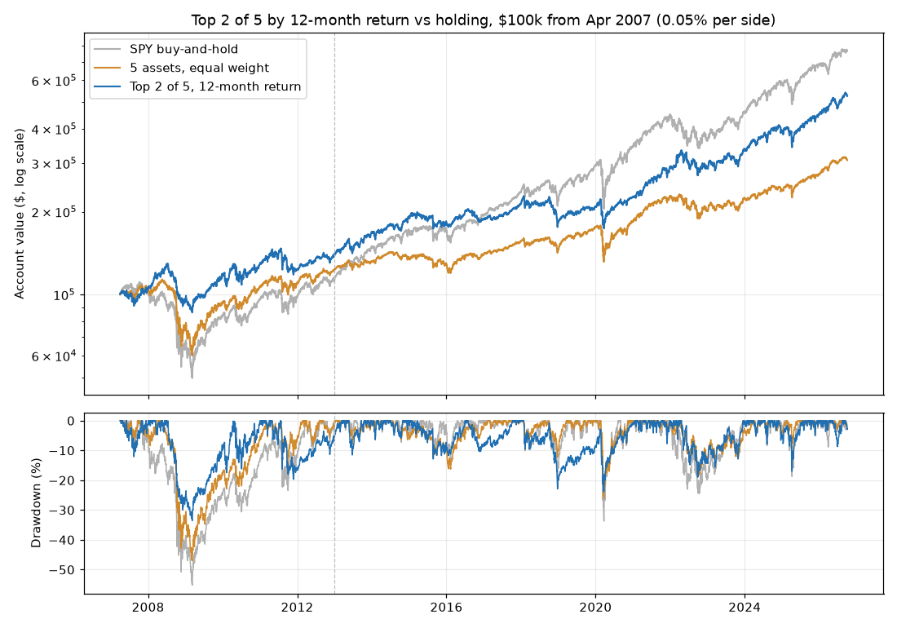

# Relative Momentum (Top 2 of 5 ETFs, 12-Month Return) Backtest — 2026-10-20

*Paper research only; not investment advice. Rules: [relative_momentum_preregistration.md](relative_momentum_preregistration.md), committed before this ran.*

## Verdict: **NO-GO** (7 of 9 bars passed)

| Bar | Result | Detail |
|---|---|---|
| 1 · Log check | PASS | 527 trades over 235 month-ends, 0 problems |
| 2 · Sharpe ≥ equal-weight hold (full) | PASS | 0.63 vs 0.41 |
| 3 · CAGR ≥ equal-weight hold (full) | PASS | 8.89% vs 5.93% |
| 4 · Max drawdown ≤ equal-weight hold's (full) | PASS | 33.6% vs 47.0% |
| 5 · Confirmation: Sharpe ≥ and CAGR ≥ equal-weight hold | PASS | Sharpe 0.74 vs 0.54; CAGR 10.17% vs 6.90% |
| 6 · 11 and 13 months pass bars 2 and 3 | PASS | 11 mo: Sharpe 0.52, CAGR 7.44% (pass); 13 mo: Sharpe 0.53, CAGR 7.51% (pass) |
| 7 · At 0.25% per side, Sharpe ≥ equal-weight hold | PASS | 0.58 vs 0.41 |
| 8 · vs SPY (full): Sharpe ≥ and drawdown ≤ SPY's | **FAIL** | Sharpe 0.63 vs 0.66; drawdown 33.6% vs 55.2% |
| 9 · vs SPY (confirmation): Sharpe ≥ 0.9 × SPY's | **FAIL** | 0.74 vs limit 0.84 (SPY 0.93) |

## Results at 0.05% per side

**Full period: 2007-04-02 to 2026-09-30**

| | Total return | Annual (CAGR) | Max drawdown | Worst year | Sharpe | Trades | Time invested |
|---|---|---|---|---|---|---|---|
| Top 2 of 5, 12-month return | +426% | 8.89% | 33.6% | 2018 (-13.0%) | 0.63 | 527 | 100% |
| 5 assets, equal weight | +208% | 5.93% | 47.0% | 2008 (-26.1%) | 0.41 | 1170 | 100% |
| SPY buy-and-hold | +666% | 11.01% | 55.2% | 2008 (-36.8%) | 0.66 | 1 | 100% |

**Discovery: 2007-04-02 to 2012-12-31**

| | Total return | Annual (CAGR) | Max drawdown | Worst year | Sharpe | Trades | Time invested |
|---|---|---|---|---|---|---|---|
| Top 2 of 5, 12-month return | +39% | 5.88% | 33.6% | 2008 (-7.7%) | 0.42 | 156 | 100% |
| 5 assets, equal weight | +23% | 3.65% | 47.0% | 2008 (-26.1%) | 0.25 | 345 | 100% |
| SPY buy-and-hold | +13% | 2.18% | 55.2% | 2008 (-36.8%) | 0.16 | 1 | 100% |

**Confirmation: 2013-01-01 to 2026-09-30**

| | Total return | Annual (CAGR) | Max drawdown | Worst year | Sharpe | Trades | Time invested |
|---|---|---|---|---|---|---|---|
| Top 2 of 5, 12-month return | +279% | 10.17% | 23.9% | 2018 (-13.0%) | 0.74 | 371 | 100% |
| 5 assets, equal weight | +150% | 6.90% | 26.2% | 2022 (-11.3%) | 0.54 | 825 | 100% |
| SPY buy-and-hold | +577% | 14.92% | 33.7% | 2022 (-18.2%) | 0.93 | 0 | 100% |

*Trades counts every buy or sell of one ETF, including small monthly rebalancing trades.*

## Turnover and concentration

- Holdings changed at 58 of 234 monthly reviews (25%).
- Months holding both stock funds (SPY + EFA) together: 25%.
- Months each fund was held: US stocks (SPY) 146, Foreign stocks (EFA) 85, Treasury bonds (IEF) 64, Real estate (VNQ) 101, Commodities (DBC) 72.

## Lookbacks (full period)

| | Total return | Annual (CAGR) | Max drawdown | Worst year | Sharpe | Trades | Time invested |
|---|---|---|---|---|---|---|---|
| 3 months (info only) | +290% | 7.23% | 36.2% | 2022 (-17.0%) | 0.49 | 609 | 100% |
| 6 months (info only) | +439% | 9.02% | 38.0% | 2022 (-16.1%) | 0.62 | 561 | 100% |
| 9 months (info only) | +447% | 9.11% | 34.2% | 2015 (-9.4%) | 0.64 | 543 | 100% |
| 11 months (bar 6) | +305% | 7.44% | 35.9% | 2018 (-10.6%) | 0.52 | 531 | 100% |
| 12 months (main) | +426% | 8.89% | 33.6% | 2018 (-13.0%) | 0.63 | 527 | 100% |
| 13 months (bar 6) | +311% | 7.51% | 32.4% | 2018 (-13.0%) | 0.53 | 538 | 100% |
| 5 assets, equal weight | +208% | 5.93% | 47.0% | 2008 (-26.1%) | 0.41 | 1170 | 100% |

## Number of funds held (12-month lookback, full period, information only)

| | Total return | Annual (CAGR) | Max drawdown | Worst year | Sharpe | Trades | Time invested |
|---|---|---|---|---|---|---|---|
| Top 1 | +322% | 7.67% | 48.2% | 2011 (-15.3%) | 0.45 | 121 | 100% |
| Top 2 (main) | +426% | 8.89% | 33.6% | 2018 (-13.0%) | 0.63 | 527 | 100% |
| Top 3 | +322% | 7.66% | 38.6% | 2008 (-21.0%) | 0.55 | 759 | 100% |

## Trading costs (full period)

| Cost per side | Rule CAGR | Rule Sharpe | Hold CAGR | Hold Sharpe | Total cost paid by rule |
|---|---|---|---|---|---|
| 0.00% | 9.07% | 0.65 | 5.95% | 0.41 | $0 |
| 0.05% | 8.89% | 0.63 | 5.93% | 0.41 | $6,369 |
| 0.10% | 8.71% | 0.62 | 5.91% | 0.41 | $12,489 |
| 0.25% | 8.18% | 0.58 | 5.86% | 0.41 | $29,443 |

## Gold versions (full period, information only)

| | Total return | Annual (CAGR) | Max drawdown | Worst year | Sharpe | Trades | Time invested |
|---|---|---|---|---|---|---|---|
| GLD instead of DBC: top 2 | +374% | 8.30% | 27.2% | 2022 (-19.1%) | 0.58 | 536 | 100% |
| GLD instead of DBC: equal weight | +302% | 7.40% | 38.2% | 2008 (-19.4%) | 0.55 | 1170 | 100% |
| All six (with GLD): top 2 | +353% | 8.06% | 36.7% | 2018 (-13.0%) | 0.53 | 542 | 100% |
| All six (with GLD): equal weight | +259% | 6.78% | 40.5% | 2008 (-21.0%) | 0.51 | 1404 | 100% |

## Data notes

- Common trading days: 5,195 (2006-02-06 to 2026-09-30); the test runs 2007-04-02 to 2026-09-30. Last complete month used: September 2026.
- Monthly log (each fund's 12-month total return and rank, the two held, rebalance day): [relative_momentum_log.csv](relative_momentum_log.csv).
- Scores use a total-return index (dividends added back on their ex-dates).
- Same cached Yahoo prices and FRED DTB3 cash rates as the trend tests; data checks are in [the trend report](multi_asset_trend_backtest_2026-10-20.md).
- Taxes are ignored. Monthly rotation would make them worse for the rule than for SPY held.

## Reading the result (review notes, written after the run)

- **Ranking clearly beats owning the basket.** Against the same five held equally it wins on every measure, in
  both periods, at nearby lookbacks and at five times the trading cost: 8.9% vs 5.9% a year, Sharpe 0.63 vs 0.41,
  worst drop 34% vs 47%. That part of the idea held up.
- **It still doesn't beat just holding SPY.** Over 2007–2026, SPY made 11.0% a year to the rule's 8.9%, with a
  slightly better Sharpe (0.66 vs 0.63). In 2013–2026 the gap is wide: 14.9% vs 10.2% a year, Sharpe 0.93 vs 0.74.
  The rule's real advantage is the smaller worst drop (34% vs 55%, and 24% vs 34% after 2013).
- **Where the 34% drop came from:** in 2008 it held commodities and Treasuries. Commodities had been the
  12-month leader (+79% in June 2008) and then fell about half in five months. That is the "former winner falls
  abruptly" risk the write-up warned about. The low point was 9 March 2009.
- **2022 worked as hoped:** commodities led and the rule held them through the stock-and-bond fall (worst 2022
  month-end score for DBC was still +18%).
- **A fragility warning:** 12 months is a good lookback by luck as much as by design. 11 and 13 months made about
  7.5% a year (Sharpe 0.52–0.53) against 8.9% for 12. They still beat the basket, so bar 6 passes, but read the
  headline number as the top of a range, not the middle.
- **Gold (information only):** swapping gold in for commodities gave a smaller worst drop (27%) but a lower Sharpe
  (0.58). Neither gold version would change the verdict.
- **Honest summary:** a real improvement over the trend test (Sharpe 0.63 vs 0.54) and a much better way to own
  these five funds, but over this window it's a smoother, lower-return alternative to SPY, not a better one. By
  the bars set in advance it's a no-go. Taxes (ignored here) would widen the gap.
- **Limits:** about 19½ years and one big bear market. US stocks had an unusually strong 2013–2026, which
  flatters the SPY comparison.
