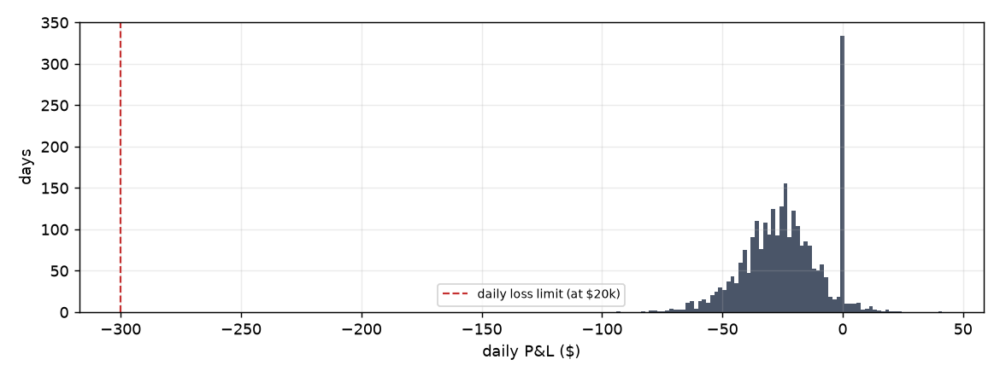

# Risk-control replay — 2016-02-03 to 2026-10-19

`main.py risk-replay`. **Real** SPY minute paths (consolidated feed) and the **production** risk engine, exit rules and kill switch. **Modelled** option prices (Black-Scholes, vol from trailing realized volatility, vol rising as SPY falls, fixed bid-ask). Trades are deliberately neutral with no assumed edge: this tests whether the controls hold on real days, not whether a strategy makes money.

## Did the controls hold?

| Check | Result |
|---|---|
| Trading days replayed | 2,692 |
| Trades opened (approved by the risk engine) | 10,559 |
| Any trade losing more than its planned max loss | **0** |
| Largest trade loss vs its max loss | $-53.20 vs $99.60 max planned |
| Days the daily loss limit triggered | 0 |
| Worst overshoot past the daily limit when it triggered | none |
| Worst single day | $-94.00 (-0.47% of $20k) |
| Days the profit ceiling triggered | 0 |
| Days the 5% drawdown warning paused new trades intraday | 44 |
| Days that started below the warning line (a person must OK trading) | 987 |
| Trade requests refused by the risk engine | 2,816 (trade_larger_than_per_trade_limit 2,816) |
| Quarters ending in a hard halt (10% drawdown) | 1 of 44 — first on 2020-12-30 |
| Worst drawdown within a quarter | 9.8% |
| Positions still open at the close | 0 (must be 0) |

## Exits

| Reason | Trades | Mean P&L |
|---|---:|---:|
| `time` | 7,973 | $-7.35 |
| `market_close` | 1,969 | $-6.16 |
| `profit_target` | 543 | $+16.24 |
| `stop_loss` | 72 | $-38.74 |
| `emergency` | 2 | $-9.70 |

Stop-loss slippage (loss beyond the stop level when the exit fired, because SPY jumped between minutes): median $-0.60, worst $-5.10 per position.

## Worst days

| Day | P&L | Lowest point intraday | Triggers |
|---|---:|---:|---|
| 2026-07-29 | $-94.00 | $-97.00 | – |
| 2020-09-04 | $-83.00 | $-86.00 | drawdown_warning_acknowledged |
| 2018-10-11 | $-80.00 | $-80.00 | – |
| 2025-11-21 | $-79.80 | $-79.80 | drawdown_warning |
| 2022-04-29 | $-78.60 | $-78.60 | – |
| 2017-01-12 | $-78.40 | $-81.40 | – |
| 2022-01-26 | $-76.00 | $-76.00 | – |
| 2022-04-05 | $-74.00 | $-74.00 | – |

## Known stress days

| Day | Event | SPY open→close | Trades | P&L | Lowest point | Triggers |
|---|---|---:|---:|---:|---:|---|
| 2016-06-24 | Brexit vote | -0.2% | 5 | $-4.80 | $-16.80 | drawdown_warning_acknowledged |
| 2018-02-05 | Volmageddon | -3.2% | 5 | $-16.00 | $-16.00 | – |
| 2018-12-24 | Christmas Eve selloff | -2.7% | 5 | $-27.00 | $-27.00 | drawdown_warning_acknowledged |
| 2020-03-09 | COVID limit-down open | -0.6% | 1 | $-5.20 | $-19.20 | – |
| 2020-03-12 | COVID crash | -3.2% | 0 | $+0.00 | $+0.00 | – |
| 2020-03-16 | COVID worst day | -0.6% | 0 | $+0.00 | $+0.00 | – |
| 2022-09-13 | hot CPI print | -2.3% | 0 | $+0.00 | $+0.00 | drawdown_warning_acknowledged |
| 2024-08-05 | yen carry unwind | +1.3% | 3 | $-41.60 | $-54.60 | – |
| 2025-04-03 | tariff announcement | -1.7% | 2 | $-21.40 | $-30.40 | – |
| 2025-04-04 | tariff selloff | -3.7% | 0 | $+0.00 | $+0.00 | – |
| 2025-04-07 | tariff whipsaw | +3.3% | 0 | $+0.00 | $+0.00 | – |
| 2025-04-09 | tariff pause rally | +9.9% | 0 | $+0.00 | $+0.00 | – |

On the most violent days the engine often opened nothing: when volatility spikes, option prices rise and these spreads stop fitting the per-trade limit, so they are refused. The limit protects the account automatically in high-volatility regimes. SPY open→close excludes the overnight gap.

## By year

| Year | Days | Trades | P&L | Worst day | Loss-limit days |
|---|---:|---:|---:|---:|---:|
| 2016 | 231 | 1,150 | $-5,252 | $-63 | 0 |
| 2017 | 251 | 1,247 | $-6,128 | $-78 | 0 |
| 2018 | 251 | 1,224 | $-6,255 | $-80 | 0 |
| 2019 | 251 | 1,248 | $-5,904 | $-68 | 0 |
| 2020 | 253 | 915 | $-6,210 | $-83 | 0 |
| 2021 | 252 | 1,125 | $-6,438 | $-72 | 0 |
| 2022 | 251 | 490 | $-4,778 | $-79 | 0 |
| 2023 | 250 | 1,144 | $-7,518 | $-66 | 0 |
| 2024 | 252 | 943 | $-6,599 | $-72 | 0 |
| 2025 | 250 | 629 | $-5,505 | $-80 | 0 |
| 2026 | 200 | 444 | $-4,161 | $-94 | 0 |

## Hard halts

In live trading each of these stops the system until a person reviews it and enters the restart authorization. In the replay, trading stays stopped for the rest of that quarter.

* 2020-12-30: drawdown_shutdown

## What this does and does not show

* It shows the sizing, limits, exits and kill switch behave as designed on real price paths, including 2018-02, 2020-03, 2022 and 2025-04.
* The P&L is not a strategy result. With no edge, spreads lose the bid-ask and fees on average; that is expected, and the drawdown controls are what stop that bleed from going further.
* Option prices are modelled. Real quotes widen sharply in a crash, so real exits on the worst days would cost more than shown here; treat overshoot numbers as a lower bound.
* Minute bars hide moves within the minute; real stop slippage can be larger.
* Stress scenarios used by the engine come from this same history (2,714 days; worst 2-hour drop -5.8% on 2025-04-07).
