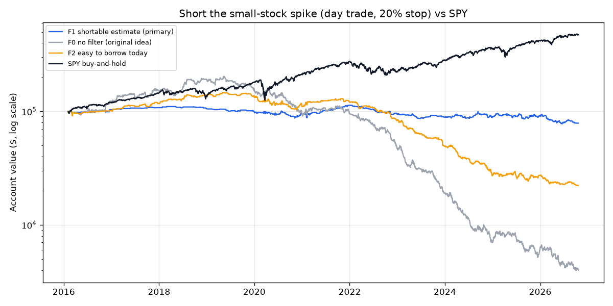

# Short the Small-Stock Spike — 2026-10-21

*Paper research only; not investment advice. Rules: [spike_short_preregistration.md](spike_short_preregistration.md), committed before any data was fetched.*

## Verdict: **NO-GO** (2 of 9 bars passed)

| Bar | Result | Detail |
|---|---|---|
| 1 · Data check | PASS | no problems |
| 2 · Enough trades (≥ 100) | PASS | 943 trades |
| 3 · Makes money after costs | **FAIL** | CAGR -2.22%, average trade -0.28% |
| 4 · Worth the risk (Sharpe ≥ SPY buy-and-hold) | **FAIL** | -0.20 vs 0.92 |
| 5 · Survivable (worst drop ≤ 25%) | **FAIL** | 31.3% |
| 6 · Consistent (positive in ≥ 70% of years with 10+ trades) | **FAIL** | 5 of 11 |
| 7 · Survives double costs | **FAIL** | CAGR -7.72% |
| 8 · Not fragile (+20% and +50% versions make money) | **FAIL** | +20%: CAGR -5.31%, avg -0.28%; +50%: CAGR +0.17%, avg +0.18% |
| 9 · Actually placeable (≥ 25% of last 20 days' signals easy to borrow today, ≥ 10 of them) | **FAIL** | 9 of 123 (7%) |

## Results (2016-02-04 to 2026-10-20)

Stocks under $8 that closed up 30%+ on $2M+ volume, shorted at the next open, 20% stop, covered at that day's close. 7.5% of the account per trade, at most 3 at once, starting with $100,000. Delisted stocks are included.

| | Trades | Winners | Avg trade after costs | Total | Annual (CAGR) | Worst drop | Sharpe | Stopped out |
|---|---|---|---|---|---|---|---|---|
| **F1 shortable estimate (primary)** | 943 | 53% | -0.28% | -21% | -2.22% | 31.3% | -0.20 | 14% |
| F1, double costs | 943 | 49% | -1.15% | -58% | -7.72% | 60.5% | -0.81 | 14% |
| F1, no costs (reference) | 943 | 55% | +0.60% | +46% | +3.60% | 17.7% | 0.44 | 14% |
| F2 easy to borrow today | 1,753 | 51% | -1.08% | -78% | -13.11% | 84.8% | -1.02 | 16% |
| F0 no filter (original idea) | 4,316 | 50% | -0.90% | -96% | -25.97% | 98.1% | -1.11 | 21% |
| F1, hold to close of t+3 | 823 | 51% | -0.31% | -24% | -2.47% | 46.8% | -0.14 | 27% |
| F1, hold to close of t+5 | 726 | 48% | -0.89% | -44% | -5.22% | 51.4% | -0.34 | 34% |
| F1, no stop | 943 | 55% | +0.24% | +12% | +1.03% | 26.1% | 0.15 | 0% |
| F0, no stop | 4,316 | 54% | -0.23% | -77% | -12.82% | 95.1% | -0.20 | 0% |
| F1, jump ≥ +20% | 2,371 | 53% | -0.28% | -44% | -5.31% | 56.6% | -0.37 | 10% |
| F1, jump ≥ +50% | 247 | 52% | +0.18% | +2% | +0.17% | 19.2% | 0.06 | 19% |
| SPY buy-and-hold | — | — | — | +373% | +15.61% | 33.8% | 0.92 | — |

Trades skipped because the short-sale rule (SSR) would have been on: 2,049 at the open (plus those flagged on the spike day). Signals skipped because 3 trades were already open: 107 (F1), 1,929 (F0).

**Year by year (account return)**

| Year | F1 trades | F1 | F0 | F2 | SPY |
|---|---|---|---|---|---|
| 2016 | 18 | +3.2% | +22.6% | +1.5% | +18.6% |
| 2017 | 23 | +4.3% | +23.7% | +15.4% | +21.7% |
| 2018 | 20 | -2.2% | +26.3% | +18.8% | -5.0% |
| 2019 | 43 | -6.4% | -21.0% | -4.5% | +31.1% |
| 2020 | 148 | -3.1% | -37.5% | -17.2% | +18.5% |
| 2021 | 102 | +18.2% | +0.5% | +9.4% | +28.6% |
| 2022 | 68 | -16.1% | -50.5% | -31.5% | -18.2% |
| 2023 | 72 | -6.1% | -59.0% | -40.2% | +26.2% |
| 2024 | 138 | +0.9% | -62.6% | -43.2% | +24.9% |
| 2025 | 198 | +1.2% | -12.3% | -2.5% | +17.7% |
| 2026 | 113 | -13.3% | -36.8% | -18.6% | +13.7% |

## The shortable estimate (F1)

Share of today's active $0.50–$8 stocks that Alpaca lists as easy to borrow, by price and 20-day median dollar volume. Cells marked ✅ (≥ 70%, ≥ 20 stocks) count as shortable in the backtest.

| Price \ $ volume/day | [0.0, 1000000.0) | [1000000.0, 5000000.0) | [5000000.0, 20000000.0) | [20000000.0, inf) |
|---|---|---|---|---|
| [0.5, 1.0) | 1% of 235 | 0% of 21 | 0% of 8 | 0% of 2 |
| [1.0, 2.0) | 26% of 330 | 68% of 62 | 74% of 19 | 40% of 5 |
| [2.0, 3.0) | 28% of 200 | 75% of 69 ✅ | 82% of 28 ✅ | 86% of 14 |
| [3.0, 5.0) | 30% of 187 | 66% of 90 | 90% of 59 ✅ | 88% of 24 ✅ |
| [5.0, 8.0) | 37% of 117 | 76% of 76 ✅ | 84% of 81 ✅ | 92% of 60 ✅ |

## Live check: last 20 trading days (2026-09-23 to 2026-10-20)

123 stocks signalled; **9** are easy to borrow on Alpaca today.

- 2026-10-19 AAME: not shortable on Alpaca
- 2026-09-30 AHG: not shortable on Alpaca
- 2026-10-05 AIFA: not shortable on Alpaca
- 2026-10-06 AIFA: not shortable on Alpaca
- 2026-09-25 AIFF: not shortable on Alpaca
- 2026-10-13 AIIO: not shortable on Alpaca
- 2026-10-02 AMOD: not shortable on Alpaca
- 2026-09-24 APUS: not shortable on Alpaca
- 2026-09-25 APUS: not shortable on Alpaca
- 2026-10-05 APUS: not shortable on Alpaca
- 2026-10-06 APUS: not shortable on Alpaca
- 2026-09-23 ARTL: not shortable on Alpaca
- 2026-10-20 ATGL: not shortable on Alpaca
- 2026-09-24 AVX: easy to borrow
- 2026-09-23 BENF: not shortable on Alpaca
- 2026-09-23 BFRG: not shortable on Alpaca
- 2026-09-29 BGIN: not shortable on Alpaca
- 2026-10-01 BIRD: not shortable on Alpaca
- 2026-10-07 BIYA: not shortable on Alpaca
- 2026-09-29 BKYI: not shortable on Alpaca
- 2026-10-13 BKYI: not shortable on Alpaca
- 2026-10-12 BMBL: easy to borrow
- 2026-10-13 BMBL: easy to borrow
- 2026-09-28 BYSI: not shortable on Alpaca
- 2026-09-28 CLRO: not shortable on Alpaca
- 2026-10-12 CLWT: not shortable on Alpaca
- 2026-09-25 CNET: not shortable on Alpaca
- 2026-10-07 CPHI: not shortable on Alpaca
- 2026-10-16 CTSO: not shortable on Alpaca
- 2026-10-02 CYCU: not shortable on Alpaca
- 2026-10-15 DRMA: not shortable on Alpaca
- 2026-09-29 DXST: not shortable on Alpaca
- 2026-09-28 EGG: not shortable on Alpaca
- 2026-10-13 ELOG: not shortable on Alpaca
- 2026-10-19 EXYN: not shortable on Alpaca
- 2026-10-08 FLYE: not shortable on Alpaca
- 2026-10-13 FLYE: not shortable on Alpaca
- 2026-09-24 FOFO: not shortable on Alpaca
- 2026-10-20 FRTT: not shortable on Alpaca
- 2026-10-19 FUFU: not shortable on Alpaca
- 2026-09-24 GCDT: not shortable on Alpaca
- 2026-09-24 GLND: not shortable on Alpaca
- 2026-10-14 GLND: not shortable on Alpaca
- 2026-09-30 GOW: not shortable on Alpaca
- 2026-10-20 HOST: not shortable on Alpaca
- 2026-10-13 ILAG: not shortable on Alpaca
- 2026-09-25 INLF: not shortable on Alpaca
- 2026-09-23 IPDN: not shortable on Alpaca
- 2026-10-06 IPDN: not shortable on Alpaca
- 2026-10-13 IZM: not shortable on Alpaca
- 2026-10-13 JBDI: not shortable on Alpaca
- 2026-10-13 JYD: not shortable on Alpaca
- 2026-09-28 KNDI: easy to borrow
- 2026-09-28 LFCR: easy to borrow
- 2026-10-12 LNKS: not shortable on Alpaca
- 2026-09-25 MGLD: not shortable on Alpaca
- 2026-10-05 MI: not shortable on Alpaca
- 2026-10-12 MNDR: not shortable on Alpaca
- 2026-10-06 MOBX: not shortable on Alpaca
- 2026-09-25 MSGY: not shortable on Alpaca
- 2026-09-29 MSGY: not shortable on Alpaca
- 2026-09-23 MSS: not shortable on Alpaca
- 2026-10-20 MYGN: easy to borrow
- 2026-10-01 NAMM: not shortable on Alpaca
- 2026-10-07 NCPL: not shortable on Alpaca
- 2026-10-12 NCPL: not shortable on Alpaca
- 2026-10-14 NXGL: not shortable on Alpaca
- 2026-10-01 NXL: not shortable on Alpaca
- 2026-10-06 OLOX: not shortable on Alpaca
- 2026-09-23 ONCO: not shortable on Alpaca
- 2026-10-05 PDSB: not shortable on Alpaca
- 2026-10-09 PDSB: not shortable on Alpaca
- 2026-10-07 PFAI: not shortable on Alpaca
- 2026-10-13 PFAI: not shortable on Alpaca
- 2026-09-24 PFSA: not shortable on Alpaca
- 2026-09-29 PFSA: not shortable on Alpaca
- 2026-09-24 PMAX: not shortable on Alpaca
- 2026-10-08 QNME: not shortable on Alpaca
- 2026-10-01 QSI: easy to borrow
- 2026-10-02 QTEX: not shortable on Alpaca
- 2026-10-05 QTEX: not shortable on Alpaca
- 2026-10-05 SAIQ: not shortable on Alpaca
- 2026-10-08 SAIQ: not shortable on Alpaca
- 2026-10-20 SAIQ: not shortable on Alpaca
- 2026-09-29 SANG: not shortable on Alpaca
- 2026-10-02 SCKT: not shortable on Alpaca
- 2026-10-05 SCKT: not shortable on Alpaca
- 2026-09-29 SDEV: not shortable on Alpaca
- 2026-10-01 SDEV: not shortable on Alpaca
- 2026-10-02 SDEV: not shortable on Alpaca
- 2026-10-01 SES: not shortable on Alpaca
- 2026-10-05 SGLY: not shortable on Alpaca
- 2026-10-12 SKYA: easy to borrow
- 2026-09-28 SMJF: not shortable on Alpaca
- 2026-10-13 SMJF: not shortable on Alpaca
- 2026-10-06 SMXT: not shortable on Alpaca
- 2026-09-24 SPHL: not shortable on Alpaca
- 2026-10-01 SSM: not shortable on Alpaca
- 2026-09-29 SSTI: easy to borrow
- 2026-09-24 STAK: not shortable on Alpaca
- 2026-10-07 SXTC: not shortable on Alpaca
- 2026-10-12 TCRT: not shortable on Alpaca
- 2026-10-13 TCRT: not shortable on Alpaca
- 2026-09-25 TDIC: not shortable on Alpaca
- 2026-10-14 TDIC: not shortable on Alpaca
- 2026-09-30 TGE: not shortable on Alpaca
- 2026-09-30 TNON: not shortable on Alpaca
- 2026-10-06 VCIG: not shortable on Alpaca
- 2026-10-01 VEEA: not shortable on Alpaca
- 2026-10-05 VEEA: not shortable on Alpaca
- 2026-10-09 VEEA: not shortable on Alpaca
- 2026-09-24 WETO: not shortable on Alpaca
- 2026-10-15 WETO: not shortable on Alpaca
- 2026-10-19 WORX: not shortable on Alpaca
- 2026-10-20 WORX: not shortable on Alpaca
- 2026-10-05 WQEY: not shortable on Alpaca
- 2026-10-16 XLAB: not shortable on Alpaca
- 2026-10-19 XLAB: not shortable on Alpaca
- 2026-09-24 YDES: not shortable on Alpaca
- 2026-10-12 YMAT: not shortable on Alpaca
- 2026-10-19 YMAT: not shortable on Alpaca
- 2026-10-02 ZNB: not shortable on Alpaca
- 2026-10-09 ZYBT: not shortable on Alpaca

## F1's 10 best and 10 worst trades

| Signal day | Symbol | Entry | Exit | Stopped | After costs |
|---|---|---|---|---|---|
| 2024-12-30 | MLGO | 207.00 | 112.80 |  | +44.9% |
| 2021-02-10 | OGI | 25.80 | 14.68 |  | +42.5% |
| 2024-09-10 | LASE | 8.73 | 5.41 |  | +37.4% |
| 2020-07-23 | ABUS | 7.98 | 4.96 |  | +37.2% |
| 2021-02-10 | IGC | 3.68 | 2.47 |  | +31.9% |
| 2023-09-12 | UP | 78.80 | 53.20 |  | +31.5% |
| 2024-08-22 | FFAI | 1575.00 | 1084.50 |  | +30.5% |
| 2020-06-08 | FOSL | 7.29 | 5.03 |  | +30.4% |
| 2021-02-10 | QNTM | 281.45 | 199.55 |  | +28.1% |
| 2024-12-11 | SFIX | 6.48 | 4.65 |  | +27.6% |
| 2022-08-10 | BNGO | 1830.00 | 2196.00 | yes | -22.0% |
| 2024-11-18 | ACRS | 3.71 | 4.45 | yes | -22.0% |
| 2024-12-20 | LAES | 3.59 | 4.31 | yes | -22.0% |
| 2025-06-02 | KIDZ | 28500.00 | 34200.00 | yes | -22.0% |
| 2025-08-11 | PUSA | 3.95 | 4.74 | yes | -22.0% |
| 2026-04-09 | ZNTL | 4.52 | 5.42 | yes | -22.0% |
| 2025-05-27 | KUST | 618.00 | 741.60 | yes | -22.0% |
| 2026-02-24 | LRMR | 3.66 | 4.39 | yes | -22.0% |
| 2025-04-16 | ZYBT | 7.93 | 9.52 | yes | -22.2% |
| 2025-09-26 | PUSA | 2.75 | 3.30 | yes | -23.0% |

Trades beyond ±100% (F0, no stop; check for bad data): 2020-06-15 UONE -302%; 2020-06-24 IPDN -160%; 2020-10-16 KXIN -147%; 2021-01-26 KOSS -231%; 2023-03-31 GFAI -134%; 2024-01-22 RVSN -115%; 2024-02-16 CPOP -138%; 2024-06-03 CCM -166%; 2024-12-12 WQEY -138%; 2024-12-17 DFNS -178%; 2025-03-21 VIVO -151%; 2026-04-08 BBGI -104%; 2026-05-12 TDIC -672%; 2026-08-14 WETO -142%; 2026-08-17 IPST -111%; 2026-09-11 FTFT -144%

Every F1 and F0 trade: [spike_short_trades.csv](spike_short_trades.csv).

## Limits (from the rules, section G)

- Past borrow availability is **estimated** from today's flags (F1), not known.
- Daily bars only: the open is assumed fillable and stops fill at the stop price + 1%. Real stops in halted or gapping stocks can fill much worse.
- Trading halts are not modelled beyond skipping gaps longer than 5 days.
- Day-trading needs a $25k+ margin account (pattern-day-trader rule). Taxes ignored.

## Information only (not pre-registered; cannot change the verdict)

Added after the verdict, to explain why the owner's earlier backtest looked good. Average return of a short,
**before costs and with no stop**, across every signal (no 3-at-a-time limit):

| | Signals | Short at spike-day close → next close | Short at spike-day close → 5 days later | Next open → next close |
|---|---|---|---|---|
| Every signal (no shortable filter) | 8,520 | mean +1.94%, median +5.42% | mean +4.47%, median +11.48% | mean +0.63% |
| Shortable estimate (F1) only | 1,211 | mean +0.28%, median +2.46% | mean −0.03%, median +4.10% | mean +1.52% |

The fade is real, but it's concentrated in the stocks you can't borrow. Among the shortable ones it's close to
zero once the occasional squeeze is counted (the mean is far below the median). Then 1–2% costs and stop-outs
turn it negative. About 1 in 4 spikes trades 20%+ above the spike-day close the next day.
