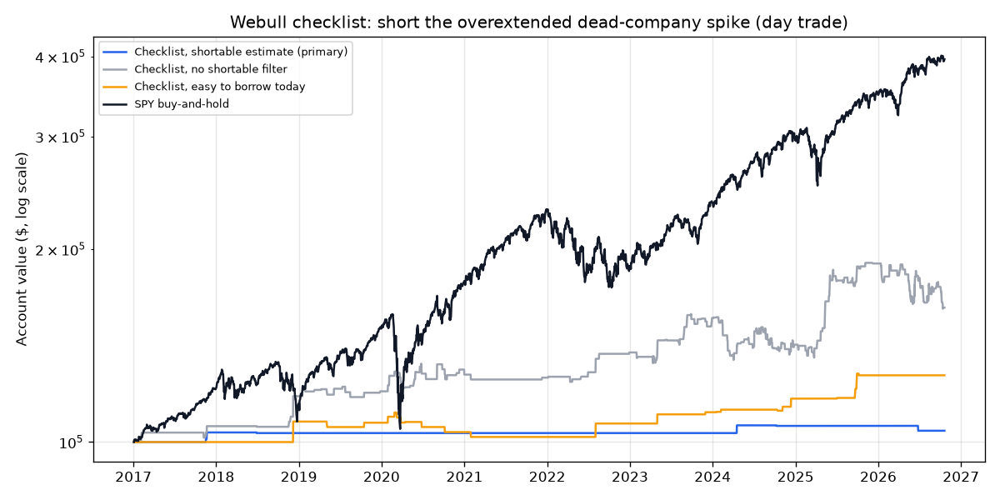

# Webull Checklist: Short the Overextended Dead-Company Spike — 2026-10-21

*Paper research only; not investment advice. Rules: [spike_short_v2_preregistration.md](spike_short_v2_preregistration.md), committed before any data was fetched.*

## Verdict: **NO-GO** (5 of 9 bars passed)

| Bar | Result | Detail |
|---|---|---|
| 1 · Data check | PASS | no problems |
| 2 · Enough trades (≥ 30) | **FAIL** | 8 trades |
| 3 · Makes money after costs | PASS | total +4.2%, average trade +3.47% |
| 4 · Worth the risk (Sharpe ≥ SPY) | **FAIL** | 0.32 vs 0.88 |
| 5 · Survivable (worst drop ≤ 25%) | PASS | 1.9% |
| 6 · Survives double costs | PASS | total +3.1% |
| 7 · Not fragile (+50% and +100% gaps average > 0) | **FAIL** | +50%: +1.24% (20); +100%: -1.36% (2) |
| 8 · Checklist filters help (with steps 3–4 beats without) | PASS | +3.47% vs -3.38% |
| 9 · Actually placeable (≥ 25% of last 120 days' signals easy to borrow today, ≥ 5) | **FAIL** | 0 of 59 (0%) |

## The funnel (2017-01-01 to 2026-10-20)

- Opened +75% or more (raw prior close $0.50–$8): **1055**
- …and a dead company (down 50%+ in a year, below 200-day average): **639**
- …and no news: **283**
- …and the intraday peak signal fired (red 5-min bar 10% off the high, $2M traded, no SSR): **274**
- …and likely shortable (F1): **8**

Why gap days produced no trade (all fetched days): traded: 1223, no rollover signal: 73, SSR in force: 1.

## Results (day trades, 15% of the account each, returns after costs)

| | Trades | Winners | Avg trade | Total | Annual | Worst drop | Sharpe | Stopped out |
|---|---|---|---|---|---|---|---|---|
| **Checklist + shortable estimate F1 (primary)** | 8 | 50% | +3.47% | +4.2% | +0.4% | 1.9% | 0.32 | 12% |
| Primary, double costs | 8 | 38% | +2.65% | +3.1% | +0.3% | 2.5% | 0.24 | 12% |
| Checklist + easy to borrow today (F2) | 24 | 67% | +6.91% | +27.1% | +2.5% | 8.4% | 0.59 | 25% |
| Checklist, no shortable filter (F0) | 274 | 55% | +1.31% | +62.1% | +5.1% | 15.2% | 0.51 | 36% |
| F1, gap ≥ +50% | 20 | 50% | +1.24% | +3.5% | +0.4% | 5.6% | 0.17 | 25% |
| F1, gap ≥ +100% | 2 | 0% | -1.36% | -0.4% | -0.0% | 0.4% | -0.45 | 0% |
| F1, all +75% gaps (skip steps 3–4) | 48 | 35% | -3.38% | -22.1% | -2.5% | 23.7% | -0.69 | 52% |
| F0, all +75% gaps (skip steps 3–4) | 982 | 51% | +0.12% | +0.4% | +0.0% | 51.0% | 0.10 | 40% |
| SPY buy-and-hold | — | — | — | +295.9% | +15.1% | 33.8% | 0.88 | — |

## Live check: last 120 trading days (2026-04-30 to 2026-10-20)

59 stocks passed steps 2–4; **0** are easy to borrow on Alpaca today.

- 2026-08-31 AEHL (+91%): not shortable on Alpaca
- 2026-05-28 ATPC (+102%): not shortable on Alpaca
- 2026-09-03 AXNX (+80%): not shortable on Alpaca
- 2026-06-09 AZI (+159%): not shortable on Alpaca
- 2026-06-01 BDAI (+119%): not shortable on Alpaca
- 2026-05-22 BIYA (+82%): not shortable on Alpaca
- 2026-07-20 BIYA (+88%): not shortable on Alpaca
- 2026-09-14 BMGL (+76%): not shortable on Alpaca
- 2026-08-20 BTCT (+84%): not shortable on Alpaca
- 2026-06-09 CHAI (+335%): not shortable on Alpaca
- 2026-05-14 CIGL (+104%): not shortable on Alpaca
- 2026-06-10 CIIT (+168%): not shortable on Alpaca
- 2026-08-25 DAIC (+110%): not shortable on Alpaca
- 2026-06-10 DSY (+421%): not shortable on Alpaca
- 2026-06-12 DSY (+77%): not shortable on Alpaca
- 2026-06-02 DXST (+86%): not shortable on Alpaca
- 2026-06-11 EDHL (+372%): not shortable on Alpaca
- 2026-06-17 EHGO (+264%): not shortable on Alpaca
- 2026-07-23 EHGO (+134%): not shortable on Alpaca
- 2026-10-08 FLYE (+150%): not shortable on Alpaca
- 2026-06-30 GIBO (+1879%): not shortable on Alpaca
- 2026-10-14 GLND (+87%): not shortable on Alpaca
- 2026-06-11 GLXG (+161%): not shortable on Alpaca
- 2026-07-10 GMM (+208%): not shortable on Alpaca
- 2026-05-18 GOVX (+146%): not shortable on Alpaca
- 2026-04-30 HCAI (+102%): not shortable on Alpaca
- 2026-06-01 HKIT (+119%): not shortable on Alpaca
- 2026-05-26 HLSQ (+86%): not shortable on Alpaca
- 2026-09-18 IMCC (+86%): not shortable on Alpaca
- 2026-08-05 INLF (+145%): not shortable on Alpaca
- 2026-09-23 IPDN (+77%): not shortable on Alpaca
- 2026-08-17 IPST (+260%): not shortable on Alpaca
- 2026-10-13 JBDI (+100%): not shortable on Alpaca
- 2026-06-30 JEM (+357%): not shortable on Alpaca
- 2026-07-06 LHSW (+278%): not shortable on Alpaca
- 2026-08-07 MB (+281%): not shortable on Alpaca
- 2026-10-05 MI (+234%): not shortable on Alpaca
- 2026-10-12 MNDR (+205%): not shortable on Alpaca
- 2026-05-26 MNTS (+76%): not shortable on Alpaca
- 2026-05-28 NCT (+112%): not shortable on Alpaca
- 2026-08-12 OFAL (+256%): not shortable on Alpaca
- 2026-08-18 PFSA (+95%): not shortable on Alpaca
- 2026-07-17 PSNYW (+265%): not shortable on Alpaca
- 2026-08-12 RMCF (+159%): not shortable on Alpaca
- 2026-05-19 RUBI (+103%): not shortable on Alpaca
- 2026-06-03 SDOT (+85%): not shortable on Alpaca
- 2026-06-26 SDOT (+86%): not shortable on Alpaca
- 2026-06-16 SLBT (+237%): not shortable on Alpaca
- 2026-05-27 SNGX (+92%): not shortable on Alpaca
- 2026-10-07 SXTC (+155%): not shortable on Alpaca
- 2026-09-22 TOPS (+80%): not shortable on Alpaca
- 2026-06-10 VSME (+349%): not shortable on Alpaca
- 2026-08-14 WETO (+195%): not shortable on Alpaca
- 2026-10-07 WORX (+455%): not shortable on Alpaca
- 2026-08-11 WXM (+168%): not shortable on Alpaca
- 2026-08-05 YXT (+182%): not shortable on Alpaca
- 2026-07-06 ZCMD (+126%): not shortable on Alpaca
- 2026-09-16 ZTG (+243%): not shortable on Alpaca
- 2026-07-20 ZYBT (+82%): not shortable on Alpaca

## Checklist trades, no shortable filter (F0): 10 best and 10 worst

| Day | Symbol | Gap | Entry | Exit | How | After costs |
|---|---|---|---|---|---|---|
| 2025-05-12 | YHC | +93% | 09:55 $6.40 | 11:44 $2.18 | stalled | +65.3% |
| 2025-06-02 | INM | +123% | 10:15 $7.06 | 15:59 $3.42 | close | +51.0% |
| 2018-12-07 | TNXP | +98% | 09:50 $6.09 | 15:59 $2.95 | close | +51.0% |
| 2025-09-29 | WOLF | +1388% | 10:50 $17.82 | 11:09 $11.00 | stalled | +37.7% |
| 2020-09-02 | WLL | +4843% | 10:05 $23.73 | 10:29 $14.93 | stalled | +36.5% |
| 2022-08-03 | HSDT | +211% | 09:55 $2.35 | 11:29 $1.55 | stalled | +33.0% |
| 2026-08-12 | OFAL | +256% | 10:15 $2.85 | 11:04 $1.95 | stalled | +30.6% |
| 2023-09-11 | SDEV | +87% | 09:45 $1.00 | 15:59 $0.69 | close | +29.1% |
| 2026-02-19 | RUBI | +85% | 09:45 $3.17 | 10:54 $2.25 | stalled | +28.0% |
| 2024-07-03 | CNSP | +108% | 10:05 $2.29 | 11:34 $1.66 | stalled | +26.5% |
| 2024-07-15 | MYSE | +88% | 09:45 $1.77 | 09:53 $1.95 | stop | -13.0% |
| 2026-05-22 | BIYA | +82% | 10:10 $1.07 | 11:08 $1.18 | stop | -13.0% |
| 2019-07-25 | HIND | +811% | 12:55 $4.97 | 15:25 $5.47 | stop | -13.0% |
| 2023-01-31 | CNTN | +85% | 09:55 $1.55 | 10:02 $1.71 | stop | -13.0% |
| 2024-12-04 | TRON | +117% | 09:45 $1.33 | 09:55 $1.46 | stop | -13.0% |
| 2026-01-16 | NEXR | +120% | 10:05 $1.57 | 10:11 $1.72 | stop | -13.0% |
| 2023-04-13 | AUUD | +85% | 09:45 $0.86 | 09:59 $0.95 | stop | -15.0% |
| 2025-06-17 | DCOY | +100% | 09:45 $1.07 | 10:23 $1.18 | stop | -15.0% |
| 2026-05-14 | CIGL | +104% | 09:45 $1.10 | 09:51 $1.21 | stop | -15.0% |
| 2024-06-10 | HOVR | +78% | 09:45 $1.02 | 09:51 $1.12 | stop | -15.0% |

Every trade: [spike_short_v2_trades.csv](spike_short_v2_trades.csv).

## Limits (from the rules, section G)

- Webull quant ratings (step 5) can't be tested; no history.
- No pre-market trading; entries from 9:45.
- Past borrow availability is estimated (F1); Webull's shortable list may differ from Alpaca's.
- Fills at 5-minute closes plus modelled costs; halts aren't modelled.
