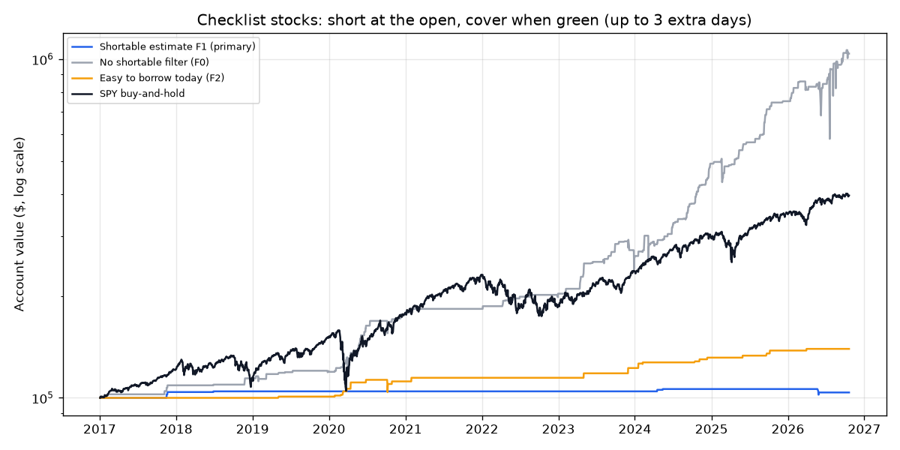

# Checklist Stocks: Short at the Open, Cover When Green — 2026-10-21

*Paper research only; not investment advice. Rules: [spike_short_v3_preregistration.md](spike_short_v3_preregistration.md). **Post-hoc follow-up**: this version was suggested by data already seen in the checklist test, so a pass would be weak evidence.*

## Verdict: **NO-GO** (6 of 9 bars passed)

| Bar | Result | Detail |
|---|---|---|
| 1 · Data check | PASS | no problems |
| 2 · Enough trades (≥ 30) | **FAIL** | 6 trades |
| 3 · Makes money after costs | PASS | total +3.7%, average trade +8.31% |
| 4 · Worth the risk (Sharpe ≥ SPY) | **FAIL** | 0.27 vs 0.88 |
| 5 · Survivable (worst drop ≤ 25%) | PASS | 3.8% |
| 6 · Survives double costs | PASS | total +3.2% |
| 7 · Not fragile (+50% and +100% gaps average > 0) | PASS | +50%: +11.55% (14); +100%: +6.42% (1) |
| 8 · Squeeze-proof enough (worst trade ≥ −100% of position) | PASS | worst -31% |
| 9 · Actually placeable (≥ 25% of last 120 days' signals easy to borrow today, ≥ 5) | **FAIL** | 0 of 35 (0%) |

## Results (2017-01-03 to 2026-10-20; 7.5% of the account per trade, at most 3 a day)

Signals skipped for the short-sale rule at the open: 147. Overnight holds pay a 20%/yr borrow fee; real fees on hard-to-borrow stocks are often much higher.

| | Trades | Winners | Avg trade | Total | Annual | Worst drop | Sharpe | Stopped |
|---|---|---|---|---|---|---|---|---|
| **F1 shortable estimate, hold up to 3 more days if red (primary)** | 6 | 83% | +8.31% | +3.7% | +0.4% | 3.8% | 0.27 | 0% |
| F1, always cover same day | 6 | 83% | +10.10% | +4.6% | +0.5% | 1.5% | 0.42 | 0% |
| F1, hold up to 2 more days | 6 | 83% | +5.04% | +2.2% | +0.2% | 3.8% | 0.17 | 0% |
| F0, always cover same day | 203 | 80% | +8.28% | +190.5% | +11.5% | 53.0% | 0.70 | 0% |
| Primary, double costs | 6 | 83% | +7.09% | +3.2% | +0.3% | 3.8% | 0.24 | 0% |
| F1, 20% stop | 6 | 67% | +0.91% | +0.4% | +0.0% | 1.7% | 0.04 | 33% |
| Easy to borrow today (F2) | 21 | 95% | +21.44% | +39.5% | +3.5% | 8.1% | 0.91 | 0% |
| No shortable filter (F0) | 203 | 89% | +15.87% | +938.0% | +27.0% | 35.8% | 1.03 | 0% |
| F0, 20% stop | 203 | 54% | +3.25% | +57.6% | +4.8% | 14.2% | 0.56 | 45% |
| F0, no costs (reference) | 203 | 92% | +17.98% | +1325.1% | +31.2% | 35.7% | 1.15 | 0% |
| F1, gap ≥ +50% | 14 | 79% | +11.55% | +12.6% | +1.2% | 3.8% | 0.47 | 0% |
| F1, gap ≥ +100% | 1 | 100% | +6.42% | +0.5% | +0.0% | 0.0% | 0.32 | 0% |
| SPY buy-and-hold | — | — | — | +295.9% | +15.1% | 33.8% | 0.88 | — |

**F0 year by year (account return)**

| Year | Trades | F0 | SPY |
|---|---|---|---|
| 2017 | 4 | +8.9% | +20.9% |
| 2018 | 2 | +4.9% | -5.0% |
| 2019 | 8 | +4.5% | +31.1% |
| 2020 | 26 | +49.7% | +18.5% |
| 2021 | 1 | +2.5% | +28.6% |
| 2022 | 8 | +10.9% | -18.2% |
| 2023 | 25 | +26.9% | +26.2% |
| 2024 | 51 | +90.7% | +24.9% |
| 2025 | 32 | +52.9% | +17.7% |
| 2026 | 46 | +38.2% | +13.7% |

## F0: the 10 worst trades (the squeezes)

| Entry day | Exit day | Symbol | Gap | Entry | Exit | After costs |
|---|---|---|---|---|---|---|
| 2026-06-03 | 2026-06-08 | SDOT | +85% | $6.08 | $20.53 | -239% |
| 2023-11-30 | 2023-12-05 | IXHL | +302% | $117.00 | $261.90 | -126% |
| 2025-02-20 | 2025-02-25 | VRM | +140% | $12.00 | $26.51 | -122% |
| 2024-03-06 | 2024-03-11 | NIKI | +126% | $32.80 | $63.30 | -95% |
| 2026-03-26 | 2026-03-31 | EEIQ | +75% | $4.79 | $8.90 | -88% |
| 2023-12-27 | 2024-01-02 | CING | +91% | $45.48 | $80.64 | -80% |
| 2026-07-20 | 2026-07-23 | ZYBT | +82% | $1.27 | $1.80 | -46% |
| 2025-02-21 | 2025-02-26 | MLGO | +172% | $93.90 | $130.80 | -42% |
| 2026-06-02 | 2026-06-05 | DXST | +86% | $2.97 | $4.14 | -42% |
| 2020-10-06 | 2020-10-09 | PPSI | +111% | $3.32 | $4.48 | -37% |

## Live check: last 120 trading days

35 signals; **0** easy to borrow on Alpaca today.

Every trade: [spike_short_v3_trades.csv](spike_short_v3_trades.csv).

## Information only (computed after the verdict; cannot change it)

**Borrow-fee sensitivity, no shortable filter (F0).** Most trades close green the same day, so the overnight
fee barely matters: hold-until-green makes +15.9% / +15.8% / +15.5% per trade at 20% / 100% / 300% a year. The
cost that would matter in practice is a broker's **locate fee** for shorting hard-to-borrow shares even for a
day, which isn't modelled here.

**The 35 trades still red at the first close** (of 203) averaged about −22% after the extra days; covering them
at that first close instead would have been far worse. Holding rescues some, but the worst squeezes (SDOT −239%,
IXHL −126%, VRM −122%) lose more than the whole position.

**20% stop (pre-registered robustness row above):** F0 drops to +3.25% per trade (54% winners, 45% stopped
out), +4.8%/yr. These stocks often trade 20%+ above the open before fading.

**Puts instead of shorting (information only, 2026-10-21).** Checklist signals since 2024-02-15 (free option data
start): 125. Listed puts 7–45 days out: **2**. Puts that traded 9:45–10:30: **0**. Puts are not a way into these
stocks.

**Interactive Brokers' public shortable list (ftp2.interactivebrokers.com, user "shortstock", free), checked
2026-10-21 14:55 ET** against the 35 signals from the last 120 trading days: IBKR shows shares available to
borrow on **33 of 35** (from 100 to 3.6M shares), at annual borrow fees mostly 40%–670% (median ~120%). Alpaca
lists all 35 as not shortable. Caveats: this is availability *today*, not on the spike morning (when demand is
highest), and the test assumed a 20%/yr fee; the sensitivity check above shows fees up to 300%/yr barely move
the result because most trades close the same day.
