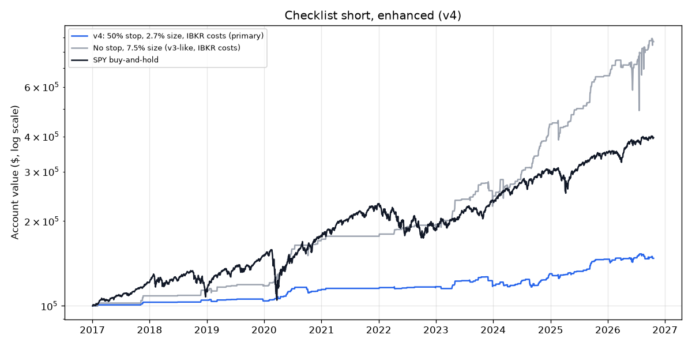

# Checklist Short, Enhanced (v4) — 2026-10-21

*Paper research only; not investment advice. Rules: [spike_short_v4_preregistration.md](spike_short_v4_preregistration.md). **Third look at the same data**: a pass is weak evidence and can only earn a forward paper (shadow) test.*

## Verdict: **NO-GO** (8 of 9 bars passed)

| Bar | Result | Detail |
|---|---|---|
| 1 · Data check | PASS | no problems |
| 2 · Enough trades (≥ 30) | PASS | 203 trades |
| 3 · Makes money after costs | PASS | total +47.6%, average trade +7.21% |
| 4 · Worth the risk (Sharpe ≥ SPY) | PASS | 0.92 vs 0.88 |
| 5 · Survivable (worst drop ≤ 25%) | PASS | 7.9% |
| 6 · Survives double costs (2% locate, 300%/yr borrow) | PASS | total +21.6% |
| 7 · Not fragile (+50% and +100% gaps average > 0) | PASS | +50%: +3.78% (376); +100%: +11.26% (133) |
| 8 · Squeeze cap works (no trade costs > 3% of the account) | **FAIL** | worst -4.62% of the account (CING 2023-12-27) |
| 9 · Placeable at IBKR (≥ 50% of last 120 days' signals, ≥ 5, have a full position to borrow today) | PASS | 31 of 35 (89%) |

## Results (2017-01-03 to 2026-10-20; at most 3 open)

Signals skipped for the short-sale rule at the open: 147. No Alpaca shortable filter (venue: IBKR).

| | Trades | Winners | Avg trade | Total | Annual | Worst drop | Sharpe | Stopped |
|---|---|---|---|---|---|---|---|---|
| **50% stop, 2.7% size, 1% locate + 150%/yr (primary)** | 203 | 77% | +7.21% | +47.6% | +4.1% | 7.9% | 0.92 | 19% |
| Primary, double costs | 203 | 73% | +3.71% | +21.6% | +2.0% | 11.1% | 0.47 | 19% |
| No locate fee | 203 | 79% | +8.21% | +55.9% | +4.6% | 7.5% | 1.04 | 19% |
| Always cover same day | 203 | 73% | +7.35% | +49.0% | +4.2% | 6.0% | 1.02 | 18% |
| 30% stop (re-sized) | 203 | 64% | +3.32% | +31.1% | +2.8% | 11.9% | 0.49 | 34% |
| 75% stop (re-sized) | 203 | 79% | +6.27% | +26.3% | +2.4% | 6.0% | 0.73 | 15% |
| 100% stop (re-sized) | 203 | 82% | +7.23% | +22.9% | +2.1% | 6.1% | 0.79 | 11% |
| No stop, 7.5% size | 203 | 86% | +14.69% | +768.0% | +24.7% | 35.9% | 0.97 | 0% |
| Gap ≥ +50% | 376 | 73% | +3.78% | +44.8% | +3.9% | 8.9% | 0.68 | 19% |
| Gap ≥ +100% | 133 | 80% | +11.26% | +49.6% | +4.2% | 4.5% | 1.19 | 18% |
| SPY buy-and-hold | — | — | — | +295.9% | +15.1% | 33.8% | 0.88 | — |

**Primary, year by year (account return)**

| Year | Trades | v4 | SPY |
|---|---|---|---|
| 2017 | 4 | +3.1% | +20.9% |
| 2018 | 2 | +1.7% | -5.0% |
| 2019 | 8 | -0.6% | +31.1% |
| 2020 | 26 | +9.8% | +18.5% |
| 2021 | 1 | +0.9% | +28.6% |
| 2022 | 8 | +1.4% | -18.2% |
| 2023 | 26 | +1.0% | +26.2% |
| 2024 | 50 | +10.0% | +24.9% |
| 2025 | 32 | +12.6% | +17.7% |
| 2026 | 46 | +0.7% | +13.7% |

## The 10 worst trades

| Entry day | Exit day | Symbol | Gap | Entry | Exit | Stopped | Trade | Account |
|---|---|---|---|---|---|---|---|---|
| 2023-12-27 | 2023-12-28 | CING | +91% | $45.48 | $120.00 | yes | -169% | -4.62% |
| 2026-08-25 | 2026-08-26 | DAIC | +110% | $3.63 | $6.21 | yes | -76% | -2.08% |
| 2026-01-16 | 2026-01-16 | NEXR | +120% | $189.42 | $284.13 | yes | -57% | -1.55% |
| 2026-07-20 | 2026-07-20 | ZYBT | +82% | $1.27 | $1.91 | yes | -57% | -1.55% |
| 2023-08-07 | 2023-08-07 | NXTS | +86% | $2023.70 | $3035.55 | yes | -57% | -1.55% |
| 2023-11-30 | 2023-11-30 | AVX | +97% | $19116.00 | $28674.00 | yes | -57% | -1.55% |
| 2024-08-20 | 2024-08-20 | TGL | +160% | $1510.00 | $2265.00 | yes | -57% | -1.55% |
| 2024-08-30 | 2024-08-30 | BRNX | +120% | $1491.00 | $2236.50 | yes | -57% | -1.55% |
| 2026-01-13 | 2026-01-13 | ALP | +100% | $91.00 | $136.50 | yes | -57% | -1.55% |
| 2024-08-23 | 2024-08-23 | MNTS | +89% | $272.39 | $408.58 | yes | -57% | -1.55% |

## Placeable at IBKR: last 120 trading days

IBKR list stamp: 2026.10.21 14:55:14. A full position = 2.7% of $100,000.

| Day | Symbol | Shares needed | IBKR available | Fee %/yr | OK |
|---|---|---|---|---|---|
| 2026-04-30 | HCAI | 247 | 100 | 159 | no |
| 2026-05-18 | GOVX | 901 | 850,000 | 85 | yes |
| 2026-05-26 | MNTS | 211 | 1,000,000 | 4 | yes |
| 2026-05-27 | SNGX | 2,766 | 3,600,000 | 123 | yes |
| 2026-05-28 | ATPC | 473 | 40,000 | 177 | yes |
| 2026-05-28 | NCT | 526 | 10,000 | 324 | yes |
| 2026-06-02 | DXST | 919 | 15,000 | 170 | yes |
| 2026-06-03 | SDOT | 449 | 45,000 | 66 | yes |
| 2026-06-09 | AZI | 931 | 7,000 | 44 | yes |
| 2026-06-09 | CHAI | 764 | 400,000 | 19 | yes |
| 2026-06-10 | CIIT | 850 | 4,000 | 121 | yes |
| 2026-06-10 | DSY | 285 | 10,000 | 77 | yes |
| 2026-06-10 | VSME | 738 | 100,000 | 243 | yes |
| 2026-06-11 | EDHL | 165 | 95,000 | 84 | yes |
| 2026-06-17 | EHGO | 568 | 10,000 | 33 | yes |
| 2026-07-06 | LHSW | 402 | 700,000 | 240 | yes |
| 2026-07-10 | GMM | 480 | 75,000 | 58 | yes |
| 2026-07-17 | PSNYW | 333 | 0 |  | no |
| 2026-07-20 | BIYA | 351 | 100,000 | 242 | yes |
| 2026-07-20 | ZYBT | 2,148 | 90,000 | 207 | yes |
| 2026-07-23 | EHGO | 662 | 10,000 | 33 | yes |
| 2026-08-05 | YXT | 373 | 75,000 | 78 | yes |
| 2026-08-07 | MB | 191 | 100 | 542 | no |
| 2026-08-17 | IPST | 345 | 75,000 | 204 | yes |
| 2026-08-18 | PFSA | 310 | 100,000 | 91 | yes |
| 2026-08-20 | BTCT | 1,771 | 650,000 | 76 | yes |
| 2026-08-25 | DAIC | 751 | 35,000 | 471 | yes |
| 2026-09-14 | BMGL | 339 | 100,000 | 107 | yes |
| 2026-09-16 | ZTG | 1,181 | 100,000 | 387 | yes |
| 2026-09-18 | IMCC | 842 | 85,000 | 508 | yes |
| 2026-09-22 | TOPS | 2,115 | 900,000 | 105 | yes |
| 2026-09-23 | IPDN | 395 | 30,000 | 465 | yes |
| 2026-10-07 | WORX | 464 | 0 |  | no |
| 2026-10-08 | FLYE | 859 | 2,000 | 668 | yes |
| 2026-10-13 | JBDI | 1,364 | 7,000 | 318 | yes |

Caveat: this is availability **today**, not on each spike morning. The forward shadow log measures that.

Every trade: [spike_short_v4_trades.csv](spike_short_v4_trades.csv).

## Information only (computed after the verdict; cannot change it)

**Why bar 8 failed:** CING (2023-12-27) closed red on day 1, was held overnight, and **opened the next morning at
$120 against a $68 stop** — a stop can't protect a gap through it. That one trade cost 4.6% of the account.

**Day-trade-only version (50% stop, cover at the close no matter what):** 203 trades, +7.35% a trade, +4.2%/yr,
worst drop 6.0%, Sharpe 1.02 (SPY 0.88), worst single trade −1.55% of the account (NEXR). On paper it clears all
nine bars, **but it was picked after seeing the failure**, so it doesn't count as a pass. It's the version a forward
shadow test should track. (Same-day with a 30% stop: +2.96% a trade, Sharpe 0.44 — the wide stop matters.)

**The trade-off in one line:** capping the squeezes works (worst drop 36% → 6–8%), but at 2.7% of the account per
short the strategy earns ~4%/yr — safe, but small next to SPY's 15%.

**Day-trade-only version, year by year (information only, post-hoc; this is what the shadow log tracks)**

| Year | Trades | Winners | Day-trade-only | v4 primary | SPY |
|---|---|---|---|---|---|
| 2017 | 4 | 4 | +3.1% | +3.1% | +20.9% |
| 2018 | 2 | 2 | +1.7% | +1.7% | -5.0% |
| 2019 | 8 | 5 | -0.6% | -0.6% | +31.1% |
| 2020 | 26 | 22 | +9.8% | +9.8% | +18.5% |
| 2021 | 1 | 1 | +0.9% | +0.9% | +28.6% |
| 2022 | 8 | 6 | +0.5% | +1.4% | -18.2% |
| 2023 | 26 | 20 | +5.7% | +1.0% | +26.2% |
| 2024 | 50 | 36 | +7.5% | +10.0% | +24.9% |
| 2025 | 32 | 25 | +11.0% | +12.6% | +17.7% |
| 2026 (to Oct 20) | 46 | 27 | +1.8% | +0.7% | +13.7% |

Whole period: +49.0% total, +4.2%/yr, worst drop 6.0%, Sharpe 1.02, 73% winners.
